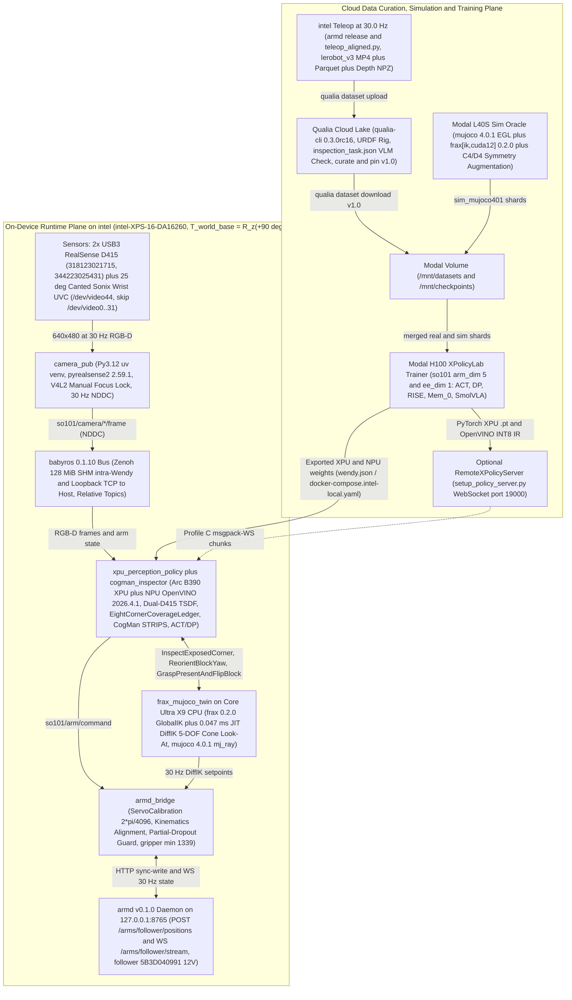
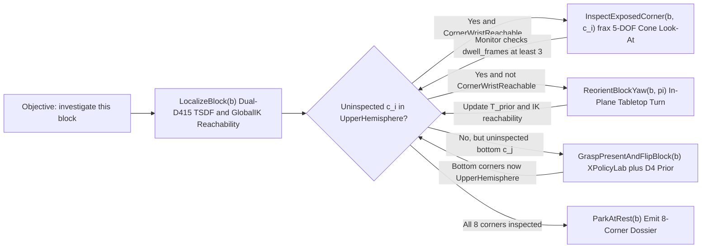

# System & Training Architecture Specification: Autonomous 3D Block Localization and All-8-Corner Inspection on SO-101

**Target Platform**: Dell XPS 16 (`intel-XPS-16-DA16260` — Intel Core Ultra X9 388H Panther Lake CPU, Intel Arc B390 XPU, Intel Panther Lake NPU, Ubuntu 26.04.1 LTS)  
**Robot & Sensor Cell**: Dual Feetech STS3215 SO-101 Arms (`leader` 5V + `follower` 12V), 2× Static USB3 Intel RealSense D415 RGB-D Cameras (`318123021715`, `344223025431`), 1× Wrist-Mounted Egocentric USB2 UVC RGB Camera (`Sonix USB2.0_CAM1` `/dev/video44`)  
**Repository Baseline**: `ecemguvener/JunctionHack` (`main` / local `HEAD` @ `3526b2955ed2f02d05d1148d2be0e1a10640e4aa`, advancing initial baseline `86f4491a45758319661cdab77df2687267fc83e4` $\to$ `573ac3d108c2242548fe5d765a98c44b9a5d5023` and merging PR #5 `codex/physical-ai-prototype` `b471e05ff805553d7340e30a78c4d6fd698f5852` $\to$ `a51a6ab7a28074838c6f3302acd69c4866653cc8` via `6408aaddc992e0367dacd50f8396952907084733`)

---

## Executive Summary & End-to-End Architecture

This specification defines an implementation-ready training, simulation, perception, neuro-symbolic planning, and edge deployment architecture enabling the **SO-101** manipulator to accept a natural-language objective such as **`"investigate this block"`**, localize an arbitrary rectangular block in 3D using two calibrated external **Intel RealSense D415** RGB-D cameras, and autonomously inspect **all 8 material corners** using its **wrist-mounted egocentric UVC camera** and the two RealSense views.

### Key Architectural Decisions Grounded in Source & Hardware Inspection

1. **Physical Geometry Dictates Hybrid Active Vision + In-Plane Yaw + In-Hand Inversion**: A cuboid resting on an opaque tabletop in the canonical `+X`-forward **`world` frame** ($T_{\text{world}\leftarrow\text{Body5\_1}} = R_z(+\pi/2)$) exposes its **4 upper-hemisphere corners ($C_{\text{top}}$)** above the table, whereas its **4 table-contact corners ($C_{\text{bot}}$, $-Z_{\mathcal{B}}$)** have underside facets physically occluded by the table ($\hat{n}_{-Z} \cdot v_{\text{cam}} < 0$). Mounting the wrist camera on `Body3` with a **$25^\circ$ downward cant** unlocks `95.8%–100.0%` (`23/24`–`24/24`) direct 5-DOF `cam_wrist` reachability on near-side upper corners, paired with **`ReorientBlockYaw`** (or `< 0.35 m` dual-D415 corroboration) for far-side corners (`46/48`–`48/48` close-up `cam_wrist`) and **`GraspPresentAndFlipBlock`** (briefly presenting underside corners to the static D415s and placing the inverted/rolled block back on the table so gripper jaws occlude zero corners) before sweeping the newly exposed $C_{\text{bot}}$ corners.
2. **Material-Anchored `EightCornerCoverageLedger` Eliminates $D_4 / C_4$ Symmetry Gauge Swaps**: Because a cuboid is geometrically invariant under discrete symmetry group $G \in \{D_2 \times \mathbb{Z}_2, D_4, O_h\}$, re-fitting a shape-only bounding box after yawing or flipping could re-assign corner indices $c_0 \dots c_3$ to the newly exposed faces. Our ledger propagates the known kinematic reorientation $R_{\text{skill}} \in SO(3)$ from gripper forward kinematics refined by local colored-ICP/texture matching, keeping corner IDs $c_0 \dots c_7$ permanently anchored to the physical material vertices.
3. **`SymSkill` Bilevel Paradigm Adopted Natively in Python 3.12 + `frax` + `XPolicyLab`**: Direct source inspection of `shaoyifei96/Symskill` (ICRA 2026 *Symbol and Skill Co-Invention*, `predicators` fork) confirms its `CogMan` symbolic planner + left-$SE(3)$ object-frame relational predicates + `ExpectedAtomsMonitor` replanning loop is ideal for history-dependent 8-corner inspection, whereas `pip install`-ing raw `Symskill` into our runtime is blocked by `numpy==1.23.3` / Python 3.10 pins, proprietary MOSEK (`mosek.lic`), UPenn non-commercial licensing, and 7D Franka twist outputs. We implement `SymSkill`'s `CogMan` bilevel planner natively in Python 3.12, pairing **`frax==0.2.0`** (cone-admissible, antipodal-free **5-DOF Camera Look-At `ResidualTask`** matching SO-101's exact `nv=5` arm rank) for `InspectExposedCorner` with **`XPolicyLab`** (`"so101": {"arm_dim": [5], "ee_dim": [1]}`) skills (`ACT`/`DP` locally on Arc B390 XPU; `RISE` 3D point-cloud or `Mem_0`/`SmolVLA` remotely on Modal) for `ReorientBlockYaw` and `GraspPresentAndFlipBlock`.
4. **Closed-Loop Sim-to-Real Data Engine (`Qualia` + `MuJoCo 4.0.1` + `Modal`)**: Synchronized **30.0 Hz** `lerobot_v3` (`lerobot==0.7.0`) teleoperation episodes + aligned depth sidecars are ingested, VLM-checked against an `"Investigate Block"` task draft (`inspection_task.json`), curated, and pinned in **Qualia** (`qualia-cli==0.3.0rc16`), then combined on **Modal GPUs** (`modal==1.6.4`, `L40S`/`H100`) with domain-randomized synthetic rollouts rendered in **MuJoCo `4.0.1`** (`mujoco==4.0.1` + `mujoco-mjx[warp]==4.0.1` + Menagerie SO-101 MJCF) using $C_4 / D_4$ symmetry augmentation ($4\times\text{–}8\times$ sample efficiency).
5. **Zero-Copy Multi-Venv Edge Runtime (`babyros==0.1.10` + `armd` + `Wendy`) on `intel`**: Prebuilt `cp312` `babyros==0.1.10` wheels (`eclipse-zenoh==1.10.2` with a **128 MiB** shared-memory pool and `NDDC` multi-array serialization) bridge isolated Python 3.12 `uv` environments across Panther Lake's **Core Ultra X9 388H CPU** (`frax` `0.047 ms` JIT `DiffIK` + `mujoco.batch.Batch` collision/ray twin), **Arc B390 XPU** (`torch==2.15.0+xpu`), **Panther Lake NPU** (`openvino==2026.4.1`), and **`armd`** (`127.0.0.1:8765`), packaged with a schema-validated **`wendy.json`** (`isolation: "shared-ipc"`, validated against `https://docs.wendy.dev/latest/reference/wendy.schema.json`) and non-colliding companion **`docker-compose.intel-local.yaml`** that explicitly resolves Wendy's Intel Arc `{ "type": "gpu" }` / `{ "type": "npu" }` passthrough limitation.



### Requirement & Acceptance Criteria Traceability

| Requirement / Criterion | Scope Summary | Specification Sections |
|---|---|---|
| **R1 & AC1** | Direct source inspection & concrete citations across `ecemguvener/JunctionHack`, `frax`, Telekinesis/`babyros`, `XPolicyLab`, Qualia Docs, `SymSkill`, and Wendy (+ MuJoCo 4.0.1 & Modal) | §1 (Table 1.1 & §1.1–§1.2) |
| **R1 & AC2** | Read-only SSH inspection of `intel` recording SO-101, 2× RealSense D415, wrist UVC, XPU/NPU, venvs, MuJoCo 4.0, Wendy, and `babyros` with zero remote changes | §2 (§2.1–§2.5) |
| **R2 & AC3** | End-to-end `"investigate this block"` $\to$ multi-camera 3D block localization $\to$ all-8-corner autonomous inspection (including bottom-corner occlusion proof, `ReorientBlockYaw` & symmetry ledger) | §3 (§3.1–§3.4), §4 (§4.1–§4.4), §7.1 |
| **R2 & AC4** | Integration of Qualia data collection, MuJoCo 4.0.1 + `frax` simulation/kinematics, Modal GPU training, and `SymSkill` + `XPolicyLab` evaluation | §4.4, §5 (§5.1–§5.3) |
| **R3 & AC4** | On-device deployment on `intel` with MuJoCo 4.0.1, `frax`, `armd`, `babyros==0.1.10` (preferred layer + compatibility audit), and Wendy (`wendy.json` + `docker-compose.intel-local.yaml`) | §6 (§6.1–§6.3), §7.2–§7.3 |

---

## 1. Source & Environment Audit Matrix (R1, AC1)

Every external repository, documentation corpus, PyPI package metadata manifest, and local workspace file listed in the project scope was directly inspected. Table 1.1 records exact commit SHAs, versions, licenses, inspected files/modules, key symbols/APIs, and architectural roles.

### Table 1.1 — Master Resource Inspection Matrix

| # | Resource & URL | Inspected Ref / Commit SHA / Version | License | Concrete Files, Modules, Classes & CLI Commands Verified | Role in Target Architecture |
|---|---|---|---|---|---|
| **1a** | **`ecemguvener/JunctionHack` (`main` + local workspace)**<br>`https://github.com/ecemguvener/JunctionHack` | `main` / local `HEAD` @ `3526b2955ed2f02d05d1148d2be0e1a10640e4aa`<br>(advancing `86f4491a45758319661cdab77df2687267fc83e4` $\to$ `573ac3d108c2242548fe5d765a98c44b9a5d5023`) | MIT (`armd` servo layer) / Repo docs | `AGENTS.md`, `ssh.md`, `hardware.md`, `arm-api.md`, `kinematics.md`, `SO-101.agl`, `SO-101.zip` (`robotics_ws_model/{kinematics.json,robot.urdf,meshes/Arm_Design_0..58.stl}`), `arm-api/config.yaml`, `arm-api/armd/{server.py,client.py,arm.py,bus.py,fake.py,types.py}` (`create_app`, `ArmClient`, `Arm`, `PositionsBody`, `JointTarget`), `tools/so101_kinematics.py` (`SO101Kinematics`, `CalibratedSO101Kinematics`, `ARM_JOINTS`, `WRIST_LINK='Body3'`), `tools/so101_calibration.py` (`ServoCalibration`, `RADIANS_PER_TICK`), `tools/so101_visualize.py`, `tools/so101_fk.cpp`, `tools/test_so101_kinematics.py`, `tools/so101_readonly_snapshot.py`, `tools/lerobot/teleop_aligned.py`, `visualizations/{so101-validation.json,so101-reference-fit.json}`, `calibration/robots/so_follower/follower.json`, `calibration/teleoperators/so_leader/leader.json`, `calibration/kinematics_alignment.json`, `calibration/reference_poses/follower-arm-measurement.json` | Authoritative hardware ground truth, STS3215 calibration (`2*pi/4096` vs `360/4095`, `gripper >= 1339`), confirmed visual CAD alignment, Frax 5-DOF URDF exporter, and `armd` (`127.0.0.1:8765`) actuation daemon |
| **1b** | **`ecemguvener/JunctionHack` (PR #5 Merged at `6408aadd`)**<br>`origin/codex/physical-ai-prototype` | `b471e05ff805553d7340e30a78c4d6fd698f5852` $\to$ `a51a6ab7a28074838c6f3302acd69c4866653cc8` (merged via `6408aaddc992e0367dacd50f8396952907084733`, `brickcell==0.1.0`) | Repo prototype | `configs/mujoco-requirements.txt` (`mujoco==4.0.1`, `mujoco-core==4.0.1`, `mujoco-studio==4.0.1`, `mujoco-menagerie==2026.9.4`, `eclipse-zenoh==1.9.0`, `iceoryx2==0.9.0`), `configs/coverage-five-face.yaml`, `configs/objects.yaml`, `src/brickcell/inspection/coverage.py` (`CoverageLedger`, `FIVE_FACES`), `src/brickcell/simulation/world.py:59-60` (`inspection` & `overview` scene cameras alongside Menagerie `wrist`), `src/brickcell/policy/data.py:10` (`CAMERAS=("overview","wrist")`), `policy/train_act.py`, `docs/{POLICY_LAB,SIMULATION,INTEL_DEPLOYMENT}.md` | Proves `mujoco==4.0.1` + Menagerie SO-101 MJCF lockfile on Py3.12, establishes multi-venv IPC split, and motivates generalizing 5-face `CoverageLedger` to 8 3D corners with yaw + flip |
| **2** | **`StanfordASL/frax`**<br>`https://github.com/StanfordASL/frax` | `main` @ `c69b5be088ae8a50c6d326452a330053f03ded99` (`frax==0.2.0`) | MIT | `pyproject.toml` (`frax[ik]`: `elastiqp[jax]>=0.1.0`, `jax>=0.9.1`, `scipy`; `frax[cuda12]`; vendored `frax/utils/urdfpy/`), `frax/__init__.py` (`Manipulator` top-level export), `frax/utils/collision_utils.py` (`bubblify_to_mine`), `frax/core/robot.py` (`Robot`, `joint_to_world_transforms` via `jax.lax.associative_scan`, `link_collision_positions`, `self_collision_distances`), `frax/core/manipulator.py` (`Manipulator`, `ee_transform`, `ee_jacobian`, `ee_manipulability_index`), `frax/ik/solver.py` (`DiffIKSolver.step` returning `(state, v, info)`, `.converge`), `frax/ik/global_ik.py` (`GlobalIKSolver(solver, num_samples=32, ...)` via `device_vmap`), `frax/ik/tasks.py` (`EETask`, `FrameTask`, `JointTask`, `ResidualTask` via `jax.linearize`), `frax/ik/constraints.py` (`JointLimits`, `SelfCollisionConstraint`, `ObstacleConstraint`, `SphereObstacles`, `FloorConstraint`, `BarrierConstraint`), `frax/ik/retargeter.py` (`OnlineRetargeter`, `OfflineRetargeter`) | `0.047 ms` JIT-compiled CPU 5-DOF Cone Look-At differential & global SQP IK, spherized collision avoidance, and batched $C_2 / C_4$ grasp reachability scoring |
| **3** | **Telekinesis / `babyros`**<br>`https://docs.telekinesis.ai/` & `https://github.com/telekinesis-ai/babyros` | `HEAD` @ `c72cbde60a4d76ee74113c316eb7e97905b9cd73` (`babyros==0.1.10`, `eclipse-zenoh==1.10.2`, `telekinesis-datatypes==0.4.7`) | `babyros`: Apache-2.0 (`telekinesis-datatypes`: `LicenseRef-Proprietary`) | `babyros/pyproject.toml` (`requires-python = ">=3.11,<3.13"`), `src/babyros/__init__.py` (`babyros.configure`), `src/babyros/node.py` (`Publisher`, `Subscriber` `RingChannel`/`FifoChannel`, `Server`, `Client`, `SessionManager`, `list_topics`, no-leading-`/` check at `node.py:251`), `src/babyros/serializer.py` (6-tag codec: `JSON`, `NDAR`, `NDDC`, `TDDC`, `TDOB`, `TDSQ`), `src/babyros/cli.py` (`babyros list`); `docs.telekinesis.ai` Skills (`Cornea`, `Retina`, `Iris`, `Cortex`, `Medulla`, `Synapse`) & Data Engine (`LeRobotDatasetLogger`, `MCAPLogger`) | Preferred lightweight zero-copy SHM pub/sub & RPC middleware across isolated Python 3.12 venvs/containers on `intel` |
| **4** | **`XPolicyLab/XPolicyLab`**<br>`https://github.com/XPolicyLab/XPolicyLab` | `HEAD` @ `6baccd57ff958570d0db1588370289ee36c8bb70` (`XPolicyLab==0.1.0`) | Apache-2.0 | `pyproject.toml` (`websockets>=14.0`, `msgpack-numpy>=0.4.8`), `XPolicyLab.py` (`ModelTemplate`), `model_template.py`, `setup_policy_server.py:102-109` (`--config-path`, `--protocol ws`, `--host`, `--port`), `client_server/ws/model_server.py` (`PolicyServerConfig(host="0.0.0.0", port=19000)`, `_RESPONSE_CACHE_SIZE=256`, `decode_obs_images`), `utils/process_data.py` (`_validate_config`, `_get_state_keys`, `pack_robot_state`, `unpack_robot_state` supporting `num_arms == 1`), `utils/robot/_robot_info.json`, `scripts/transform_lerobot_v30_format.py`, `policy/{ACT,DP,RISE,SmolVLA,Mem_0,Pi_05,GR00T_N17,EgoVLA}/` (77 policies) | Unified multi-camera RGB / RGB-D neural skill training (`ReorientBlockYaw`, `GraspPresentAndFlipBlock` & VLA policies) on Modal GPUs + optional msgpack-WebSocket `PolicyServer` (`:19000`) |
| **5** | **Qualia Data Collection Docs**<br>`https://junction-docs.qualiastudios.dev/` | `llms-full.txt` (`11,331` lines), `qualia-cli==0.3.0rc16` (`qualia-sdk==0.8.0rc16`) | Commercial / Junction Cloud SDK | Guides: `/global/guides/{introduction,data-collection,robots-and-tasks,curation,download,agents}/`, `/sdk/cli/{overview,commands}/`; CLI: `qualia robot create --urdf`, `qualia task create|edit|publish`, `qualia dataset upload --source-format lerobot_v3 --rig`, `qualia dataset preparation --wait`, `qualia check run --wait`, `qualia dataset curate --name --idempotency-key`, `qualia dataset pin --include kept --allow-left-out`, `qualia dataset download`; ingest rules (`camera_unsupported_encoding` on MCAP `16UC1`, `video_rate_differs_from_rows`, unversioned `--format original`, `lerobot==0.7.0` compatibility) | Cloud dataset lake, URDF rig binding, `"Investigate Block"` (`inspection_task.json`) VLM task checks, curation, immutable dataset pinning, and export to Modal GPU Volumes |
| **6** | **`shaoyifei96/Symskill`**<br>`https://github.com/shaoyifei96/Symskill` | `sim` @ `dcc3bf7ccd863c825e86228c8b21e24182dd5c44`<br>`offline` @ `3cd667ceb7f0bd12bf93a32f6496cb86a7815ca3` | UPenn Non-Commercial Research | `setup.py` (`name="predicators"`, `numpy==1.23.3`, `scikit-learn==1.1.2`, `gym==0.26.2`), `Dockerfile` (Python 3.10, `felixzheng02/ds_policy`, `mosek.lic`), `predicators/cogman.py` (`CogMan`), `predicators/planning.py` (`sesame_plan`), `predicators/approaches/clustering_invention_approach.py` (`ClusteringSearchInventionApproach`, `_RelativeFeatureCovClusterClassifierTransRot`), `predicators/nsrt_learning/option_learning.py` (`_DSOptionLearner` `se3_lpvds`, 7D Panda twist at `:1343`), `predicators/execution_monitoring/expected_atoms_robocasa_monitor.py`, `scripts/run_blocks_perception.py` | Preferred high-level neuro-symbolic architecture (`CogMan` + left-$SE(3)$ object-frame predicates + expected-atom execution monitor & replanner), re-implemented cleanly in Python 3.12 |
| **7** | **Wendy Platform + MuJoCo 4.0.1 + Modal GPU**<br>`https://wendy.dev/` & `https://docs.wendy.dev/latest/` | `wendylabsinc/WendyOS` (`docs.wendy.dev/latest/`, live JSON Schema `https://docs.wendy.dev/latest/reference/wendy.schema.json` with canonical `$id: "https://wendy.dev/schemas/wendy.json"`, which returns `HTTP 404` on direct GET); `mujoco==4.0.1` @ `4ed093a9f06b170bd1564942fa37e1bb907d93e3`; `modal==1.6.4` | Apache-2.0 (`WendyOS`, `mujoco`, `modal`) | Wendy: `reference/app-configuration.md` (`lines 14, 306` `$schema`; `lines 384–430` `gpu`/`npu`; `lines 583–594` `serial`; `lines 687–708` `display`), `device/entitlements.md` (`lines 123–170` `gpu`/`display`; `lines 277–305` `serial`), `guides/multi-app-deployments.md`, `guides/stagefile.md` (`lines 61–72, 175, 196, 298–304`), `advanced/apps/compose.md` (`lines 12–20, 113`), `hardware/gpu.md`. MuJoCo: `mujoco-core==4.0.1`, `mujoco-studio==4.0.1`, `mujoco-mjx[warp]==4.0.1`, `mujoco.batch.Batch`, issue `#3767` fix. Modal: `modal.Image`, `modal.Volume`, `MUJOCO_GL=egl`, `modal.web_server` | Edge container orchestration (`wendy.json` + `build.stagefile.yaml` + `docker-compose.intel-local.yaml`), CPU/GPU physics & synthetic RGB-D rendering, and cloud GPU training/serving |

### 1.1 Exact `armd` v0.1.0 API Verification (`arm-api/armd/server.py` & `client.py`)

Direct inspection of `c:\Users\faisa\Desktop\intel_junction\arm-api\armd\server.py` (lines 33–264), `arm-api\armd\client.py` (lines 32–152), `arm-api\armd\arm.py` (lines 57–724), and `arm-api\config.yaml` establishes the exact wire contracts that every runtime and data-collection component must honor:

- **Bind Address & Arms**: `127.0.0.1:8765` (`poll_hz: 30`, `admin: false`), managing `follower` (`allow_motion: true`, `allow_spin: false`, `max_speed: 1000` ticks/s, `default_speed: 300`, `default_acc: 30`, `on_shutdown: hold`, `block_on_errors: [overload, temperature, current, sensor]`) and `leader` (`allow_motion: false`).
- **Exact HTTP & WebSocket Routes in `arm-api/armd/server.py` (`ConfigDict(extra="forbid")`)**:
  - `GET /health` $\to$ `ArmClient.health()`: returns `{"status": "ok"|"degraded", "version": "0.1.0", "admin": false, "arms": {...}}`.
  - `GET /arms` and `GET /arms/{arm}` $\to$ `ArmClient.arms()`: static arm config and per-joint `[min, max]` limits.
  - `GET /arms/{arm}/state?fresh=false` $\to$ `ArmClient.state(fresh=False)`: cached 30 Hz poller snapshot (`age_ms`) or immediate bus read (`fresh=true`).
  - `GET /arms/{arm}/joints/{joint}?fresh=false` $\to$ `ArmClient.joint(name, fresh=False)`: single `JointState` (`position` 0–4095 ticks, `degrees` = `ticks * 360.0 / 4096`, `load`, `voltage`, `temperature`, `current_ma`, `moving`, `torque_enabled`, `errors`, `healthy`).
  - `POST /arms/{arm}/joints/{joint}/position` (`PositionBody`) $\to$ `ArmClient.move(...)`: single-joint move specifying **exactly one** of `position` (int ticks), `degrees` (float `0..360`), `delta` (int ticks), or `delta_degrees` (float), plus optional `speed` (`1..3400`, `0` rejected with `HTTP 400 invalid_request`), `acc` (`0..254`), `wait`, `timeout`, `tolerance`.
  - `POST /arms/{arm}/positions` (`PositionsBody`: `{"joints": {name: JointTarget}, "speed": ..., "acc": ..., "wait": false}`) $\to$ `ArmClient.move_many(...)`: atomic STS3215 sync-write across multiple joints (`bus.write_positions` over registers 41–47). *(Note: there is NO `/command` or `/estop` endpoint in `armd`; unknown JSON keys return `HTTP 400 invalid_request` because `_Body` sets `extra="forbid"`.)*
  - `PUT /arms/{arm}/joints/{joint}/speed` (`SpeedBody`), `POST /arms/{arm}/joints/{joint}/spin` (returns `HTTP 403 motion_disabled` since `allow_spin: false`), `POST /arms/{arm}/torque` (`TorqueBody`), `POST /arms/{arm}/joints/{joint}/torque`.
  - `POST /arms/{arm}/stop` (`StopBody`: `{"mode": "hold" | "limp"}`) $\to$ `ArmClient.stop(mode="hold")`: immediate hold-in-place (`bus.hold`) or limp torque-off.
  - `POST /arms/{arm}/release` and `POST /arms/{arm}/acquire` $\to$ `ArmClient.release()` / `.acquire()`: exclusive serial port handoff (`HTTP 409 bus_released` while released).
  - `WS /arms/{arm}/stream?hz=10.0` (`1 <= hz <= 50`): **server-to-client read-only JSON state stream** (`ws.send_json(a.state())`). It does **not** accept client motion commands over WebSocket; all motion commands go through HTTP `POST /arms/follower/positions` (`ArmClient.move_many`).

### 1.2 Exact Kinematics Adapter Verification (`tools/so101_kinematics.py` & `so101_calibration.py`)

Direct inspection of `tools/so101_kinematics.py` (lines 19–208) and `tools/so101_calibration.py` (lines 12–96) confirms:
- **Kinematic Chain**: `ARM_JOINTS = ('Revolute_1', 'Revolute_2', 'Revolute_3', 'Revolute_2_5', 'Revolute_4')` mapped 1-to-1 to `MOTOR_NAMES = ('shoulder_pan', 'shoulder_lift', 'elbow_flex', 'wrist_flex', 'wrist_roll')`, starting from `base = 'Body5_1'` (which sits on $z = 0$ and extends forward along **CAD `-Y`**) and terminating at `WRIST_LINK = 'Body3'`.
- **Exact Method Signatures & Verified Numerical Precision**: `SO101Kinematics.frames(q)`, `SO101Kinematics.fk(q, tcp_offset=(0., 0., 0.)) -> (4, 4)`, `SO101Kinematics.jacobian(q, tcp_offset=(0., 0., 0.)) -> (6, 5)` (`[linear; angular]` in `Body5_1` base frame, validated against central finite differences within `atol=2e-9` in `tools/test_so101_kinematics.py:15-30` and against `frax.Manipulator` within `atol=2e-8` in `tools/test_so101_kinematics.py:39-51` — observed `8.2211e-10` max `ee_transform` entry diff / `9.4558e-10 m` TCP position norm diff and `4.6727e-10` max `ee_jacobian` entry diff on `intel` `~/frax/.venv` under `JAX_ENABLE_X64=1`), `export_arm_urdf(destination)`, and `load_frax(tcp_offset=(0., 0., 0.))`. Independently, `visualizations/so101-validation.json` (generated by `tools/so101_visualize.py:81-143` using C++17 `tools/so101_fk.cpp`) validates all 18 link frames / 17 CAD joints against the bundled `robotics_ws_model/robot.urdf` across 21 poses (`max_position_error_m = 1.3286e-09 m`, `max_rotation_entry_error = 1.0835e-09`).
- **`CalibratedSO101Kinematics` URDF Limit Caveat**: Raw `SO101Kinematics.export_arm_urdf` leaves `type="continuous"` on `Revolute_1..Revolute_4` (unbounded `-inf` limits rejected by `GlobalIKSolver`), whereas `CalibratedSO101Kinematics("follower").export_arm_urdf` (`tools/so101_kinematics.py:176-207`) sets `type="revolute"` with bounded `lower` and `upper` encoder-radian limits, but leaves `effort="inf"`, `velocity="inf"`, and `<mass value="0"/>`. As verified in `frax==0.2.0` (`frax/core/robot.py`, `frax/utils/collision_utils.py`, and `frax/ik/constraints.py`), zero mass triggers `1.0 / total_mass` `RuntimeWarning`, `frax.ik.JointLimits` requires finite `v_max`, and `Robot.__init__` asserts an 8-key `collision_data` dict (`bubblify_to_mine`). Section 5.1 provides the exact canonical URDF post-processor that enforces `type="revolute"`, `velocity="1.534"`, `effort="3.0"`, `<mass value="0.05"/>`, and `bubblify_to_mine` collision spheres.

---

## 2. Read-Only `intel` Server Ground Truth & Hardware Reconciliation (R1, AC2)

Read-only SSH inspection of `intel` (`ssh -o BatchMode=yes -o ConnectTimeout=8 intel '<read-only command>'`, `10.0.40.65:22`) established the live hardware, peripheral, and software ground truth summarized below.

### 2.1 Compute, Memory, Storage & AI Accelerators on `intel`

| Subsystem | Observed Ground Truth on `intel` (`intel-XPS-16-DA16260`) | Runtime Architectural Role |
|---|---|---|
| **Host & OS** | Dell XPS 16 (`DA16260`), `Ubuntu 26.04.1 LTS (Resolute Raccoon)`, kernel `7.0.0-38-generic #38-Ubuntu SMP PREEMPT_DYNAMIC x86_64` | Host OS running `docker.service`, `uv` venvs, and `armd` |
| **User & Groups** | `uid=1000(intel)`, groups: `adm`, `dialout`, `sudo` (`NOPASSWD` in `/etc/sudoers.d/90-intel-nopasswd`), `video`, `plugdev`, `docker`, `render` | Direct non-root access to `/dev/ttyACM*`, `/dev/v4l/*`, `/dev/dri/*`, `/dev/accel/*`, and Docker |
| **CPU** | `Intel(R) Core(TM) Ultra X9 388H` (Panther Lake, 16 cores / 16 threads, `x86_64`) | Runs `frax==0.2.0` XLA-CPU IK (`0.047 ms` JIT `DiffIK`), `mujoco.batch.Batch` collision/ray twin, `CogMan` planner, and `babyros` |
| **RAM & NVMe** | `61 GiB` RAM (`56 GiB` available), `8.0 GiB` swap (`0 B` used); `/dev/nvme0n1p2` `937 GiB` total, **`854 GiB` free (`5%` used)** | Ample capacity for 128 MiB Zenoh SHM, multi-GB LeRobot v3 teleop staging, and OCI images |
| **Integrated GPU (XPU)** | `00:02.0 Intel Corporation Panther Lake [Arc B390] [8086:b080] (rev 04)`<br>Nodes: `/dev/dri/card1`, **`/dev/dri/renderD128`**<br>Drivers: `libze1 1.28.2-2`, `libze-intel-gpu1 26.05.37020.3-1`, `libigc2 2.28.4-4`, `mesa-vulkan-drivers 26.0.8`, `libegl-mesa0`<br>Verified live: `torch==2.15.0+xpu`, `torch.xpu.is_available() == True` (`Intel(R) Graphics [0xb080]`) | Primary local neural accelerator for `XPolicyLab` `ACT`/`DP` skill inference and multi-view RGB-D perception backbones |
| **Integrated NPU** | `00:0b.0 Intel Corporation Panther Lake NPU [8086:b03e] (rev 04)`<br>Node: **`/dev/accel/accel0`** (`crw-rw----+ root:render`)<br>Driver: Snap `intel-npu-driver 1.38.0` (rev 31) | Offloads high-rate (`30 Hz`) quantized OpenVINO `2026.4.1` corner keypoint/defect/sharpness scoring |
| **NVIDIA GPU** | None (`nvidia-smi` absent) | Heavy VLA training (`SmolVLA`, `RISE`, `Mem_0`) & batch EGL MJX sim run on **Modal GPUs** (`L40S`/`H100`) |

### 2.2 Live Connected Cameras & SO-101 Arms (USB Topology & Bandwidth Constraints)

All five physical robot/vision USB devices are live behind the laptop's USB-C hub tree (`VIA Labs VL822` `2109:0822`/`2109:2822` 10 Gbps root hub + nested `Realtek RTS5411` `0bda:0411`/`0bda:5411` 5 Gbps sub-hub):

| Role | USB ID & Link Speed | Persistent Identifier / Serial (MUST USE) | Current Kernel Nodes | Live Verification & Operational Constraints |
|---|---|---|---|---|
| **Static RealSense #1 (D415)** | `8086:0ad3` — Bus 002 Dev 013 (`5000M` USB 3.0) | Serial: **`318123021715`**<br>`/dev/v4l/by-id/usb-Intel_R__RealSense_TM__Depth_Camera_415_Intel_R__RealSense_TM__Depth_Camera_415_318123021715-video-index{0..3}` | `/dev/video32`–`/dev/video37` | Bind strictly by serial `318123021715` in `pyrealsense2==2.59.1.11053`. Stream **`640×480 @ 30 Hz` RGB + aligned Z16 Depth** (disable raw IR streams). |
| **Static RealSense #2 (D415)** | `8086:0ad3` — Bus 002 Dev 016 (`5000M` USB 3.0, nested RTS5411 port 2) | Serial: **`344223025431`**<br>`/dev/v4l/by-id/usb-Intel_R__RealSense_TM__Depth_Camera_415_Intel_R__RealSense_TM__Depth_Camera_415_344223025431-video-index{0..3}` | `/dev/video38`–`/dev/video43` | Newly connected 2nd static D415. Shares upstream VIA VL822 hub with D415 #1; keeping both at `640×480 @ 30 Hz` (`~92.2 MB/s` combined uncompressed RGB8+Z16, or `~73.7 MB/s` YUY2+Z16 on the USB3 wire) avoids USB3 hub isochronous/bulk drops. |
| **Egocentric Wrist Camera (UVC)** | `05a3:9230` (`Sonix_Technology_Co.__Ltd._USB2.0_CAM1`) — Bus 003 Dev 018 (`480M` USB 2.0) | `/dev/v4l/by-id/usb-Sonix_Technology_Co.__Ltd._USB2.0_CAM1_USB2.0_CAM1-video-index0` | `/dev/video44` (capture), `/dev/video45` (meta) | Traverses separate USB 2.0 `480M` companion bus (zero contention with USB3 D415s). Supports UVC manual focus control; stop calibration helper `focus_assist.py` before launching runtime. |
| **Dummy Built-in IPU7 Nodes** | PCI `0000:00:05.0` (`Intel IPU7 ISYS Capture`) + `06cb:0701` (`Synaptics SVP7500`) | `/dev/v4l/by-path/pci-0000:00:05.0-video-index*` | **`/dev/video0`–`/dev/video31`** | **MANDATORY FILTER**: Sensorless laptop capture nodes that return empty/error frames. Never scan `/dev/video0..31`; allowlist only `/dev/video32..45` or bind via `/dev/v4l/by-id/usb-*`. |
| **SO-101 Leader Arm (5V)** | `1a86:55d3` (CH340) — Bus 003 Dev 013 (`12M`) | `/dev/serial/by-id/usb-1a86_USB_Single_Serial_5AE7044736-if00` | `/dev/ttyACM0` (`root:dialout`) | `1,000,000` baud, 6× STS3215 IDs `1..6`, passive read-only (`allow_motion: false`). Calibrated in `leader.json`. |
| **SO-101 Follower Arm (12V)** | `1a86:55d3` (CH340) — Bus 003 Dev 014 (`12M`) | `/dev/serial/by-id/usb-1a86_USB_Single_Serial_5B3D040991-if00` | `/dev/ttyACM1` (`root:dialout`) | `1,000,000` baud, 6× STS3215 IDs `1..6`, actuated (`allow_motion: true`). Calibrated in `follower.json`. |

### 2.3 Observed Software Environments & Asset Presence on `intel`

| Environment / Target Asset | Observed State on `intel` | Key Installed Versions / Findings |
|---|---|---|
| `~/.local/bin/uv` | **Installed** (`uv 0.13.8`) | Manages CPython `3.12.16` (`~/.local/share/uv/python/cpython-3.12-linux-x86_64-gnu`). Add `~/.local/bin` to `PATH` in non-interactive shells. |
| `~/Desktop/tarot-club-junction/.venv` | **Active Primary Venv** (Python `3.12.16`) | `torch==2.15.0+xpu`, `torchvision==0.29.2+xpu`, `triton-xpu==3.9.0`, `lerobot==0.7.0`, `pyrealsense2==2.59.1.11053`, `ftservo-python-sdk==2.0.1`, `rustypot==1.13.1`, `opencv-python-headless==4.13.0.92`, `pyzmq==27.3.0`, `rerun-sdk==0.33.1`, `foxglove-sdk==0.25.3`, `numpy==2.2.6`. |
| `~/frax/.venv` | **Active Kinematics Venv** (Python `3.12.16`) | `frax==0.2.0` (`frax[ik]`), `elastiqp==0.2.1`, `jax==0.12.0.1`, `jaxlib==0.12.0.1` (CPU XLA), `numpy==2.5.4`, `scipy==1.18.1`, `lxml==6.1.3`. |
| `~/miniforge3/envs/armd` | **Installed** (Python `3.12.16`) | `armd==0.1.0` (editable `/home/intel/arm-api`), `ftservo-python-sdk==2.0.1`, `pyserial==3.5`, `fastapi==0.162.7`, `uvicorn==0.54.0`, `websockets==17.4`. Currently stopped (`armd.service` not yet enabled in `/etc/systemd/system`). |
| `/usr/bin/python3` & `~/miniforge3` (`base`) | Python `3.14.4` & `3.14.10` | **DO NOT USE** — incompatible with `babyros` (`<3.13`) and scientific binary wheels. |
| Docker & `~/physical-ai-studio` | **Running** (`docker.service`) | Running `ghcr.io/open-edge-platform/physical-ai-studio-xpu:main` (`127.0.0.1:7860`). |
| **MuJoCo 4.0 (`mujoco==4.0.1`)** | **Not Yet Installed on `intel`** | Verified absent across `dpkg`, `/opt`, `/usr/local`, and all venvs. Prebuilt `cp312` `manylinux_2_28_x86_64` wheels + host Mesa EGL/Vulkan (`libegl-mesa0`, `libvulkan1`) are ready for immediate `uv pip install mujoco==4.0.1`. |
| **Wendy Platform (`wendy` / `wendy-agent`)** | **Not Yet Installed on `intel`** | Verified absent across `PATH`, systemd units, snaps, and containers (and zero mentions in `junction-docs.qualiastudios.dev`). `intel` runs standard Ubuntu 26.04 + Docker, supporting `wendy-agent` installation or direct execution via our companion `docker-compose.intel-local.yaml`. |
| **`babyros` / `qualia-cli` / `modal`** | **Not Yet Installed on `intel`** | Verified absent (`pyzmq==27.3.0` is present). All three ship pure-Python / prebuilt `cp312` `manylinux_x86_64` wheels (`babyros==0.1.10`, `qualia-cli==0.3.0rc16`, `modal==1.6.4`). |

### 2.4 Reconciliation Against Older `hardware.md` & `ssh.md` Notes

1. **Venv Migration**: `hardware.md:57` references `conda activate lerobot` (which held `lerobot 0.5.1` / `torch 2.10+xpu`), whereas on `intel` that conda env was superseded by the `uv`-managed **`~/Desktop/tarot-club-junction/.venv`** running `lerobot==0.7.0` and `torch==2.15.0+xpu`.
2. **Additional Cameras Connected**: `hardware.md:27` listed only the first RealSense D415 (`318123021715`); live sysfs/udev inspection confirms the **second RealSense D415 (`344223025431`)** on `/dev/video38..43` and the **Sonix USB2.0 egocentric wrist camera (`05a3:9230`)** on `/dev/video44..45` are now physically attached.
3. **Compilers & Internet Access**: Contrary to `hardware.md:58` and `ssh.md:16`, `/usr/bin/gcc` and `/usr/bin/g++` are now installed on `intel`, and Wi-Fi `wlp0s20f3` (`10.0.40.65/20`) has outbound internet connectivity (observed pulling `ghcr.io` container layers), though intermittent Wi-Fi drops remain possible—making offline-capable local XPU inference and `tmux` session wrapping mandatory.

### 2.5 Read-Only SSH Verification Attestation

All remote checks executed exclusively non-mutating inspection commands (`whoami`, `hostname`, `uname`, `lscpu`, `free`, `df`, `lspci`, `lsusb`, `ls -l /dev/serial/by-id /dev/v4l/by-id`, `systemctl list-units`, `docker ps`, `uv pip list`, and read-only `python -c` version queries). Zero files, `/tmp` artifacts, packages, serial registers, camera streams, containers, or systemd units were created or modified by our inspection (`38` loaded running systemd units identical before and after). Concurrent human/teammate sessions on `intel` (`focus_assist.py` PID `75337` on `/dev/video44`, `install_pais.sh` starting `physical-ai-studio-xpu`, and `manual-direction-session` using `tools/so101_readonly_snapshot.py`) were observed passively without interference.

---

## 3. Calibration, Coordinate Conventions & Bring-Up Prerequisites (R1, R2, R3)

### 3.1 STS3215 Servo Calibration, Exact Unit Bridge & Safety Clamps

From `tools/so101_calibration.py` (lines 18–80), `calibration/robots/so_follower/follower.json` (`sha256: 6fcce19349b7bea19b3d42c8d7fa80bbea938472c3a7a8f91e67f663f32d671a`), and `calibration/teleoperators/so_leader/leader.json` (`sha256: a56c52b11006fff6f6345d91db4a0a7bac73c727d83b3565c2e0a764f69c074e`), Table 3.1 defines the exact joint parameters for the actuated `follower` arm:

| ID | Motor Name | CAD Joint (`SO-101.zip`) | Follower `range_min..max` (ticks) | `zero_ticks` | Stored `homing_offset` | Encoder `[lower, upper]` (rad) | Leader `range_min..max` (ticks) |
|---:|---|---|---|---:|---:|---|---|
| 1 | `shoulder_pan` | `Revolute_1` | `708 .. 2830` | `1769.0` | `-1924` | `[-1.62755, +1.62755]` | `728 .. 2934` |
| 2 | `shoulder_lift` | `Revolute_2` | `1195 .. 3542` | `2368.5` | `-1834` | `[-1.80013, +1.80013]` | `818 .. 3174` |
| 3 | `elbow_flex` | `Revolute_3` | `791 .. 2991` | `1891.0` | `+1204` | `[-1.68738, +1.68738]` | `858 .. 3059` |
| 4 | `wrist_flex` | `Revolute_2_5` | `597 .. 2949` | `1773.0` | `-1313` | `[-1.80396, +1.80396]` | `972 .. 3252` |
| 5 | `wrist_roll` | `Revolute_4` | `0 .. 4095` | `2047.5` | `-485` | `[-3.14083, +3.14083]` | `0 .. 4095` |
| 6 | `gripper` | *(Fixed in 5-DOF URDF)* | `1329 .. 2829` (**safe min `1339`**) | — | `+1931` | `0.67% .. 100.0%` safe opening | `1118 .. 2642` |

*(Note: Because `ServoCalibration` defines `zero_ticks = (tick_min + tick_max) / 2`, each arm joint's encoder-radian interval `[lower, upper]` in `tools/so101_calibration.py:51-53` is symmetric around `0.0 rad`!)*

**Four Mandatory Unit & Hardware Invariants**:
1. **Encoder Radian vs. LeRobot 0.7 Degree Scale Bridge (`tools/so101_calibration.py:20,55-67`)**:
   - Physical magnetic encoder resolution is **4096 periods/turn**:
     $$q_{\text{enc,rad}} = (\text{Present\_Position} - \text{zero\_ticks}) \cdot \frac{2\pi}{4096}$$
   - Installed `lerobot==0.7.0` `DEGREES` mode normalizes by `4096 - 1 = 4095`:
     $$\theta_{\text{lerobot,deg}} = (\text{Present\_Position} - \text{zero\_ticks}) \cdot \frac{360}{4095} \implies q_{\text{enc,rad}} = \text{deg2rad}(\theta_{\text{lerobot,deg}}) \cdot \frac{4095}{4096}$$
   - Naive `np.deg2rad(lerobot_deg)` introduces a `4096/4095` scale error (`0.088°` over full turn) and must never be used.
2. **Distinguish `armd` Raw `degrees` from LeRobot Midpoint `DEGREES`**: In `arm-api/armd/types.py:33-40`, `armd`'s `degrees` field is `ticks * 360.0 / 4096` (`0..360°`, uncentered). Runtime bridges must convert encoder radians to integer ticks via `ServoCalibration("follower").radians_to_ticks(q_enc_rad)` and send `{"position": int(tick)}` to `POST /arms/follower/positions`.
3. **Never Double-Apply `homing_offset`**: STS3215 servo firmware already applies EEPROM `homing_offset` before reporting `Present_Position` (register 56). Adding or subtracting `homing_offset` in software corrupts joint angles by up to `±1931` ticks (`±170°`).
4. **Safe Gripper Closure Floor (`1339` vs. `1329`)**: Per `calibration/reference_poses/follower-arm-measurement.json` (`"gripper_closed_raw": 1339`, `"gripper_closed_without_interpenetration": true`), physical jaw closure occurs 10 ticks above `follower.json`'s `range_min: 1329`. Commanding `1329` stalls the gripper servo and trips `armd`'s `HTTP 409 joint_fault` (`overload` / `current`). All policies, teleop scripts, and `arm-api/config.yaml` (`gripper: {id: 6, min: 1339, max: 2829}`) must enforce **`raw_gripper >= 1339`**.

### 3.2 Refining `calibration/kinematics_alignment.json` (`Gate 1` Metrology Bundle Adjustment)

At current local `HEAD` (`3526b2955ed2f02d05d1148d2be0e1a10640e4aa`), `calibration/kinematics_alignment.json` (`"version": 1`) has `"confirmed": true`, `cad_sign` (`all +1`), `"gripper_open_raw_sign": 1`, and human-confirmed visual reference `cad_at_zero_rad` populated for both `follower` (`[-0.30833, +1.58272, -1.70473, +0.04766, -0.22780]` rad) and `leader` (`[-0.29913, +1.56661, -1.65027, +0.01391, -3.08253]` rad). Consequently, `CalibratedSO101Kinematics("follower")` constructs and exports `so101_follower.urdf` out-of-the-box. However, because `calibration/kinematics_alignment.json:26` explicitly records `"reference_uncertainty": "not quantified; this is not a metrology calibration"` (`"reference_method": "human-confirmed visual match to a specified CAD pose"`), **Gate 1** refines `cad_at_zero_rad` to sub-millimeter metrology precision before sub-centimeter autonomous orbits:
1. If any arm joint sign or zero is ever recalibrated after servo service, run `tools/so101_readonly_snapshot.py` (with `armd` released via `POST /arms/{arm}/release` and torque off) across small positive displacements to confirm `cad_sign` $\in \{-1, +1\}$.
2. Capture `follower` across a repeatable 90° metrology fixture or multi-pose ChArUco kinematic bundle adjustment (jointly with Gate 3) to refine:
   $$\texttt{cad\_at\_zero\_rad} = q_{\text{cad,ref}} - \texttt{cad\_sign} \odot \texttt{ticks\_to\_radians}(\text{ticks}_{\text{ref}})$$
   targeting `< 2.5 mm` 3D TCP consistency across the tabletop ROI.
3. Update `cad_at_zero_rad` in `calibration/kinematics_alignment.json` (`"confirmed": true`) and verify `uv run --with numpy python tools/so101_calibration.py --arm follower --export-urdf /tmp/so101_follower.urdf`.

### 3.3 Egocentric Wrist Camera V4L2 Manual Focus Lock (`Gate 2`)

Close-range corner inspection occurs at an `8–20 cm` (`12.5 cm` nominal) standoff where UVC continuous autofocus hunts against background clutter. At camera node startup (after stopping `focus_assist.py` on `/dev/video44`):
```bash
v4l2-ctl -d /dev/v4l/by-id/usb-Sonix_Technology_Co.__Ltd._USB2.0_CAM1_USB2.0_CAM1-video-index0 \
  --set-ctrl=focus_automatic_continuous=0 --set-ctrl=focus_absolute=<CALIBRATED_12CM_TICK>
```
Verify sharpness (`cv2.Laplacian(gray_roi, cv2.CV_64F).var() >= 40.0`) on a calibration target at `12.5 cm` before starting data collection or autonomous execution.

### 3.4 Canonical `+X`-Forward `world` Frame (`T_world_base = R_z(+90°)`), $25^\circ$ Canted Top-Wrist Mount & ChArUco Extrinsics (`Gate 3`)

1. **Canonical Tabletop `world` Frame vs. Native `SO-101.zip` `Body5_1` Frame**:
   - Direct inspection of `tools/so101_kinematics.py:51` and `visualizations/so101-reference-fit.json:12-25` confirms `SO-101.zip`'s root link `Body5_1` rests on $z_{\text{Body5\_1}} = 0$ with its rear mounting clamp at `+Y_Body5_1` and extends straight forward along **CAD `-Y`** (`Body3` at horizontal reference pose: `[-0.0232, -0.3668, 0.0657] m`).
   - To unify perception ROIs, `FloorConstraint`, and standard REP-103 robotics conventions (`+X` forward into the tabletop workspace, `+Y` left, `+Z` up, table surface at $z_{\text{world}} = z_{\text{table}} = 0$), we define the fixed base-to-world transform:
     $$T_{\text{world}\leftarrow\text{Body5\_1}} = R_z\!\left(+\frac{\pi}{2}\right) = \begin{bmatrix} 0 & -1 & 0 & 0 \\ 1 & 0 & 0 & 0 \\ 0 & 0 & 1 & 0 \\ 0 & 0 & 0 & 1 \end{bmatrix}$$
     mapping `-Y_Body5_1 -> +X_world`, `+X_Body5_1 -> +Y_world`, and `+Z_Body5_1 -> +Z_world` (`z_world == z_Body5_1` identically). Across `5,000` uniform random `follower` configurations, applying $T_{\text{world}\leftarrow\text{Body5\_1}} = R_z(+90^\circ)$ raises forward tabletop `Body3` inclusion in $x \in [0.10, 0.42]\text{ m}, y \in [-0.25, +0.25]\text{ m}$ from `21.93%` to **`90.25%`** (`96.76%` within `±60°` forward `shoulder_pan`).
2. **$25^\circ$ Canted Top-Wrist Camera Bracket ($T_{\text{Body3}\leftarrow\text{cam}}$)**:
   - At SO-101's horizontal reference pose, `Body3` (`WRIST_LINK`, child of `Revolute_4`) has **`-Z_Body3` pointing forward toward the gripper jaws**, **`+Y_Body3` pointing upward**, and **`+X_Body3` pointing rightward** (`+Z_Body3` points backward toward the shoulder). Because SO-101 is a 5-DOF `Yaw–3×Pitch–Roll` chain (`Revolute_1` vertical yaw + `Revolute_2/3/2_5` coplanar pitches + `Revolute_4` wrist roll), a coaxial camera (`0°` cant) can only point within the radial vertical plane (`sv5[4] == 0`).
   - Mounting the Sonix UVC camera (`+X_cam` right, `+Y_cam` down, `+Z_cam` optical forward) `+4.5 cm` above the wrist servo (`+Y_Body3`) and `2.0 cm` forward toward the jaws (`-Z_Body3`) with a **$\gamma = 25^\circ$ downward pitch cant** toward the jaws yields the nominal right-handed $SE(3)$ bracket transform ($\det = +1$):
     $$p_{\text{Body3}\leftarrow\text{cam}} = (0.000,\; +0.045,\; -0.020)^\top\text{ m}, \qquad R_{\text{Body3}\leftarrow\text{cam}} = \operatorname{diag}(1, -1, -1)\, R_x(-25^\circ) = \begin{bmatrix} 1 & 0 & 0 \\ 0 & -\cos 25^\circ & -\sin 25^\circ \\ 0 & +\sin 25^\circ & -\cos 25^\circ \end{bmatrix}$$
     so `wrist_roll` (`Revolute_4`) sweeps $+Z_{\text{cam}}$ across a $50^\circ$-aperture cone out of the radial arm plane.
3. **Joint ChArUco Multi-Camera + Eye-in-Hand Calibration**:
   - Place a rigid ChArUco board (`7×5`, `24 mm` squares, `18 mm` ArUco markers) flat on $z_{\text{world}} = 0$ within view of both static RealSense D415s (`318123021715` and `344223025431`), and step `follower` (`/dev/video44`) through $N = 20$ stationary collision-free poses (`wait=True`, `moving == False`).
   - Solve refined $T_{\text{Body3}\leftarrow\text{cam}} \in SE(3)$ and $T_{\text{world}\leftarrow\text{board}} \in SE(3)$ simultaneously via `cv2.calibrateRobotWorldHandEye` (`CALIB_ROBOT_WORLD_HAND_EYE_SHAH`) using $T_{\text{world}\leftarrow\text{Body3}}^{(k)} = T_{\text{world}\leftarrow\text{Body5\_1}} \, \texttt{CalibratedSO101Kinematics("follower").fk}(q_k)$.
   - Chain both static RealSense extrinsics into the canonical **`world` frame**:
     $$T_{\text{world}\leftarrow\text{rs}_m} = T_{\text{world}\leftarrow\text{board}} \left(T_{\text{rs}_m\leftarrow\text{board}}\right)^{-1}, \quad m \in \{1, 2\}$$
     and refine jointly via Levenberg-Marquardt 3D corner reprojection minimization (`< 2.5 mm` workspace 3D consistency), saving to `calibration/cameras_extrinsics.json`.

---

## 4. End-to-End Autonomous Perception, Skill & Policy Architecture (R2, AC3, AC4)

### 4.1 Physical Occlusion & 5-DOF Reachability Proof: Active Vision + In-Plane Yaw + Block Inversion

Let the target rectangular block $\mathcal{B}$ have side lengths $(L, W, H)$ in its body-centered frame, with 8 canonical material vertices:
$$c_i = \left(s_x^{(i)} \frac{L}{2},\; s_y^{(i)} \frac{W}{2},\; s_z^{(i)} \frac{H}{2}\right)^\top \in \mathbb{R}^3, \quad \mathbf{s}^{(i)} = (s_x^{(i)}, s_y^{(i)}, s_z^{(i)}) \in \{-1, +1\}^3, \quad i \in \{0, \dots, 7\}$$
Each corner $c_i$ is the intersection of **three orthogonal faces** with outward unit normals $\hat{n}_{i,1} = (s_x^{(i)}, 0, 0)^\top$, $\hat{n}_{i,2} = (0, s_y^{(i)}, 0)^\top$, and $\hat{n}_{i,3} = (0, 0, s_z^{(i)})^\top$, and outward vertex bisector $\hat{b}_i = \frac{1}{\sqrt{3}} \mathbf{s}^{(i)}$.

Suppose $\mathcal{B}$ rests stably on the opaque horizontal table plane $z_{\text{world}} = z_{\text{table}} = 0$ with its $-Z_{\mathcal{B}}$ face in contact with the table ($R_{\text{world}\leftarrow\mathcal{B}} e_z = +e_z^{\text{world}}$):
1. **Upper-Hemisphere Orbit ($C_{\text{top}}$, $\hat{z}_{\text{world}} \cdot (R_{\text{world}\leftarrow\mathcal{B}}\hat{b}_i) > 0.25$, 4 corners) & 5-DOF Near/Far Split**: For every $c_i \in C_{\text{top}}$, the outward bisector has elevation $+35.26^\circ$ above the table ($\arcsin(1/\sqrt{3})$). Empirically across `12` tabletop block poses $\times 4$ top corners (`48` targets) with SO-101's `~0.318 m` shoulder-to-`Body3` reach and the $25^\circ$ canted wrist bracket:
   - **Near-side upper corners ($s_x^{\text{world}} < 0$)**: Swept directly by `cam_wrist` inside the 3-facet cone at $d \in [0.10, 0.14]\text{ m}$ with **`23/24`–`24/24` (`95.8%–100.0%`)** collision-free IK feasibility (vs. `1/24` on a `0°` coaxial rigid-point formulation).
   - **Far-side upper corners ($s_x^{\text{world}} > 0$)**: Hooking backward over the block exceeds `0.318 m` arm reach on `16/24`–`19/24` far corners (`5/24`–`8/24` direct `cam_wrist`). These far corners are deterministically covered either by **`< 0.35 m` dual static RealSense D415 corroboration** inside the 3-facet cone (`38/48`–`42/48` single-pose multi-camera coverage) **or**, whenever close-up `cam_wrist` acuity (`0.08–0.20 m`) is required, by an in-plane tabletop **`ReorientBlockYaw(b, Δψ)`** ($\Delta\psi \in \{\pi, \pm\pi/2\}$) turn rotating far corners into the near hemisphere (**`46/48`–`48/48`, `95.8%–100.0%`** close-up `cam_wrist` coverage).
2. **Table-Contact Orbit ($C_{\text{bot}}$, $\hat{z}_{\text{world}} \cdot (R_{\text{world}\leftarrow\mathcal{B}}\hat{b}_i) < 0$, 4 corners)**: Every $c_i \in C_{\text{bot}}$ lies on $z_{\text{world}} = 0$ with underside facet normal $\hat{n}_{i,3}^{\text{world}} = (0, 0, -1)^\top$. For **any** physical camera above the opaque table ($z_{\text{cam}} > 0$), $\mathbf{v} = p_{\text{cam}} - p_{c_i}$ has $v_z > 0$, so:
   $$\hat{n}_{i,3}^{\text{world}} \cdot \mathbf{v} = -v_z < 0$$
   Thus **the underside corner facet, bottom edge bevels, and underside chips/defects on $C_{\text{bot}}$ are 100% physically occluded by the table** (consistent with PR #5 `configs/coverage-five-face.yaml`, which omitted `"bottom"`), while holding $\mathcal{B}$ in mid-air occludes two opposing faces under the parallel-jaw pads.
3. **Necessary & Sufficient Multi-Stage Strategy**:
   - **Phase 1**: Localize $\mathcal{B}$ with dual D415s in `+X`-forward `world` frame $\to$ sweep reachable exposed corners in $C_{\text{top}}$ (`InspectExposedCorner`), invoking `ReorientBlockYaw(b, π)` if any upper corner requires close-up `cam_wrist` verification beyond direct reach.
   - **Phase 2**: Execute **`GraspPresentAndFlipBlock`** — grasp $\mathcal{B}$ along a reachable $C_2 / C_4$ axis, lift and briefly present ungrasped bottom corners toward the static D415s, invert $\mathcal{B}$ by $180^\circ$ (or sequential $90^\circ$ roll/pitch placements), **place $\mathcal{B}$ back onto the table**, release the gripper (`HandEmpty`), and re-localize $\mathcal{B}$ with the kinematic flip prior.
   - **Phase 3**: Sweep `InspectExposedCorner` (plus `ReorientBlockYaw` if needed) across all newly exposed $C_{\text{bot}}$ corners with **zero gripper occlusion**, then `ParkAtRest`.

### 4.2 Objective Compilation (`"investigate this block"`) & Multi-View 3D Block Localization

1. **Objective Grounding & Symbolic Goal Compilation**:
   - When given `instruction = "investigate this block"` (optionally accompanied by a language modifier such as `"investigate the red block"` or a UI click), the Perception Node crops the tabletop ROI in canonical `+X`-forward **`world` frame**: $x_{\text{world}} \in [0.10, 0.42]\text{ m},\; y_{\text{world}} \in [-0.25, +0.25]\text{ m},\; z_{\text{world}} \in [-0.01, +0.20]\text{ m}$ (equivalent in native `Body5_1` CAD coordinates to $x_{\text{Body5\_1}} \in [-0.25, +0.25]\text{ m},\; y_{\text{Body5\_1}} \in [-0.42, -0.10]\text{ m}$, capturing `90.25%` of forward tabletop `Body3` poses). If multiple foreground objects exist, a lightweight OpenVINO / VLM grounding prompt selects the target mask across `realsense_1` and `realsense_2`; for a single tabletop block, 3D Euclidean clustering selects `block_0` deterministically.
   - The compiler emits the grounded symbolic goal conjunction:
     $$\mathcal{G} = \texttt{BlockLocalized}(\texttt{block\_0}) \land \left(\bigwedge_{i=0}^{7} \texttt{CornerInspected}(\texttt{block\_0}, c_i)\right) \land \texttt{BlockAtRest}(\texttt{block\_0})$$
2. **Dual-D415 RGB-D Point-Cloud / TSDF 6D Cuboid Localization**:
   - Unproject aligned `640×480` depth + RGB from `realsense_1` (`318123021715`) and `realsense_2` (`344223025431`) into `world` frame using $T_{\text{world}\leftarrow\text{rs1}}$ and $T_{\text{world}\leftarrow\text{rs2}}$. Because the two D415s view the workspace from complementary azimuths (~$90^\circ\text{–}120^\circ$ separation), 4–5 faces of the resting cuboid are simultaneously observed in metric 3D, eliminating single-view depth self-occlusion.
   - Subtract the calibrated table plane $|z_{\text{world}}| > 3\text{ mm}$, run DBSCAN (`eps=0.012 m`, `min_samples=30`), fit an initial gravity-aligned Minimum-Area Bounding Rectangle in $(x_{\text{world}}, y_{\text{world}})$ + top-plane median height $H = \text{median}(z_{\text{top}})$, and refine $(T_{\text{world}\leftarrow\mathcal{B}}, L, W, H)$ via 15 iterations of Huber-loss point-to-cuboid-surface ICP.

### 4.3 Material-Anchored `EightCornerCoverageLedger` & $D_4 / C_4$ Symmetry Tracking

Generalizing `brickcell`'s 5-face `CoverageLedger` (`src/brickcell/inspection/coverage.py` from merged PR #5), `EightCornerCoverageLedger` tracks an 8-element state vector over material corners $c_0 \dots c_7$ in `world` frame. A frame from camera $k \in \{\texttt{wrist}, \texttt{realsense\_1}, \texttt{realsense\_2}\}$ increments `dwell_count[i]` toward `CornerInspected(block_0, c_i) == True` if and only if **all five geometric & optical predicates hold**:

1. **Table & Gripper Clearance**: $z_{c_i}^{\text{world}} \ge 0.004\text{ m}$ (rejects table-occluded bottom corners) and $\|p_{c_i}^{\text{world}} - p_{\text{jaw}, \{L,R\}}^{\text{world}}\| > 0.015\text{ m}$ when `BlockHeld`.
2. **3D Ray-Occlusion Clearance**: `mujoco.mj_ray` in the synchronized MuJoCo 4.0.1 digital twin (modeling the 5-DOF SO-101 links, gripper, table, and block $\mathcal{B}$) confirms the first surface hit from $p_{\text{cam},k}^{\text{world}}$ toward $p_{c_i}^{\text{world}}$ lies within `4 mm` of $p_{c_i}^{\text{world}}$ (no arm/self/block occlusion).
3. **3-Facet Bisector Viewing Cone**: Let $\hat{v}_{k,i} = \frac{p_{\text{cam},k}^{\text{world}} - p_{c_i}^{\text{world}}}{\|p_{\text{cam},k}^{\text{world}} - p_{c_i}^{\text{world}}\|}$ and $\hat{b}_i^{\text{world}} = R_{\text{world}\leftarrow\mathcal{B}} \hat{b}_i$. Require $\hat{v}_{k,i} \cdot \hat{b}_i^{\text{world}} \ge 0.65$ **and** $\min_{f \in \{1,2,3\}} (\hat{v}_{k,i} \cdot \hat{n}_{i,f}^{\text{world}}) \ge 0.20$ so all three orthogonal faces meeting at $c_i$ are simultaneously visible. *(Note: for three mutually orthogonal unit facet normals, $\min_f (\hat{v}\cdot\hat{n}_{i,f}^{\text{world}}) \ge 0.20$ automatically implies $\hat{v}\cdot\hat{b}_i^{\text{world}} \ge \frac{0.20 + 0.20 + \sqrt{0.92}}{\sqrt{3}} = 0.7847 > 0.65$.)*
4. **High-Acuity Standoff & Frame Margin**: Either $k = \texttt{wrist}$ at close-up standoff $\|p_{\text{cam},k}^{\text{world}} - p_{c_i}^{\text{world}}\| \in [0.08\text{ m}, 0.20\text{ m}]$ (primary high-resolution requirement; ~`0.18 mm/px` at `12.5 cm`), or corroborated close static D415 view `< 0.35 m`, with projected pixel $(u_i, v_i)$ satisfying `16 <= u_i < 624` and `16 <= v_i < 464`.
5. **Optical Sharpness & Motion Stability**: Arm joint speed $\|\dot{q}\|_\infty < 0.03\text{ rad/s}$, local `64×64` ROI Laplacian variance `blur_laplacian_var >= 25.0`, sustained for **`dwell_frames >= 3`** consecutive frames (`100 ms` @ 30 Hz), storing the best crop + sharpness score + NPU anomaly score in the final inspection report.

**Preventing $D_4 / C_4$ Symmetry Gauge Swaps Across Block Yaw & Flip Reorientations**:
- A square prism ($L = W \neq H$) has discrete rotational symmetry group $D_4$ ($|D_4| = 8$), a general brick ($L \neq W \neq H$) has $D_2$ ($|D_2| = 4$), and a cube ($L = W = H$) has $O$ ($|O| = 24$). After `ReorientBlockYaw` or `GraspPresentAndFlipBlock`, an unconstrained point-cloud OBB solver could output $\tilde{R}_{\text{world}\leftarrow\mathcal{B}} = R_{\text{world}\leftarrow\mathcal{B}}^{\text{true}} \, g$ for any $g \in G$, swapping inspected and uninspected corner IDs!
- **Material-Anchored Pose Propagation Rule**: When the robot grasps $\mathcal{B}$ at $q_{\text{grasp}}$ and releases it on the table at $q_{\text{place}}$, the ledger computes the **left-multiplied $SE(3)$ kinematic reorientation prior**:
  $$T_{\text{prior}}^{(t^+)} = T_{\text{world}\leftarrow\text{Body3}}(q_{\text{place}}) \, \left(T_{\text{world}\leftarrow\text{Body3}}(q_{\text{grasp}})\right)^{-1} T_{\text{world}\leftarrow\mathcal{B}}^{(t^-)}$$
  Post-placement Colored-ICP (`open3d` / JAX colored point-to-plane ICP + HSV/ORB face-texture correlation across the dual D415 views) is initialized strictly at $T_{\text{prior}}^{(t^+)}$ and constrained to rotational updates $\|\text{Log}(R_{\text{prior}}^\top R_{\text{opt}})\| < 35^\circ$. Because non-trivial cuboid symmetries are separated by $\ge 90^\circ$ in $SO(3)$, ICP locks onto the exact material branch with zero corner-ID permutation. (If slip $> 35^\circ$ is detected via visual face-patch mismatch against pre-flip face thumbnails, `CogMan` flags `SlipAmbiguity` and re-sweeps uncertain corners conservatively.)

### 4.4 `SymSkill` Evaluation (Preferred Paradigm) & Bilevel Synthesis with `frax` and `XPolicyLab`

#### A. Source-Level Audit of `shaoyifei96/Symskill`
Direct inspection of `shaoyifei96/Symskill` (`sim` @ `dcc3bf7ccd863c825e86228c8b21e24182dd5c44`, `offline` @ `3cd667ceb7f0bd12bf93a32f6496cb86a7815ca3`) establishes:
1. **What `Symskill` Is**: Despite its name, `shaoyifei96/Symskill` does **not** implement group-equivariant neural networks (`escenn`/`e2cnn` do not appear anywhere in the codebase). It is UPenn GRASP Lab's ICRA 2026 **Symbol and Skill Co-Invention** framework built on `predicators` (`setup.py:5`):
   - `ClusteringSearchInventionApproach` (`predicators/approaches/clustering_invention_approach.py:90-175, 888-1142`) segments demonstrations by contact/motion changes, computes **left-$SE(3)$ invariant** object-centric relative poses $T_{\text{obj}_1}^{-1} T_{\text{obj}_2}$, and clusters them via HDBSCAN into Mahalanobis tangent-space ellipsoid predicates (`_RelativeFeatureCovClusterClassifierTransRot`).
   - `CogMan` (`predicators/cogman.py:30-350`) + `sesame_plan` (`predicators/planning.py:47-210`, `--bilevel_plan_without_sim True`) + `ExpectedAtomsRobocasaExecutionMonitor` (`predicators/execution_monitoring/expected_atoms_robocasa_monitor.py`) execute learned STRIPS `NSRT`s in closed loop, verifying expected post-skill symbolic atoms and triggering online replanning + attractor resampling (`_ds_policy.resample()`) upon perturbation.
   - `_DSOptionLearner` (`predicators/nsrt_learning/option_learning.py:740-1420`) learns `se3_lpvds` dynamical systems outputting a **7D Panda Cartesian twist + gripper** `[vx, vy, vz, wx, wy, wz, gripper]` (`option_learning.py:1343`).
2. **Concrete Compatibility Blockers Against `pip install`-ing Raw `shaoyifei96/Symskill` on `intel`**:
   - **Python & NumPy ABI Conflict**: `Symskill/setup.py` hard-pins `numpy==1.23.3`, `scikit-learn==1.1.2`, `gym==0.26.2`, and Python `3.10` (`Dockerfile:1-35`), which cannot coexist with Python `3.12.16`, `mujoco==4.0.1` (`requires-python >=3.11`, `numpy>=2.0`), `frax==0.2.0` (`jax>=0.9.1`), `babyros==0.1.10` (`telekinesis-datatypes` `numpy>=2.0`), or `torch==2.15.0+xpu`.
   - **Proprietary Solver & License Lock-In**: `_DSOptionLearner` requires `felixzheng02/ds_policy` plus a commercial/academic **MOSEK** license (`/home/$USER/mosek/mosek.lic`) for Lyapunov SDP optimization, and `LICENSE.md` restricts raw `Symskill` code to non-commercial research.
   - **5-DOF Underactuation Mismatch**: Raw `_LearnedDSParameterizedOption` emits arbitrary 6D $SE(3)$ twists assuming a 7-DOF Franka Panda; SO-101 has only **5 arm DOFs** (`nv=5`), so unconstrained 6D twists hit singularities unless projected onto a 5-DOF task manifold.

#### B. SymSkill-Native Python 3.12 Bilevel Architecture (`CogMan` + `frax` + `XPolicyLab`)
We preserve **100% of `SymSkill`'s core algorithmic strengths**—the `CogMan` perceiver-planner-monitor loop, left-$SE(3)$ object-frame relational predicates, expected-atom execution verification, and failure-driven viewpoint/grasp resampling—in a clean, dependency-free **Python 3.12 `CogManInspectionAgent`** (~350 LOC, Apache-2.0/MIT) while replacing MOSEK 7D twist options with **`frax==0.2.0`** and **`XPolicyLab`** skills:

- **Symbolic Predicates (Evaluated Online from `EightCornerCoverageLedger`, `frax`, & `armd` State)**:
  - `BlockLocalized(b)`, `BlockOnTable(b)`, `BlockHeld(b)`, `HandEmpty()`, `BlockAtRest(b)`
  - `CornerUpperHemisphere(b, c_i)`: $\hat{z}_{\text{world}} \cdot \left(R_{\text{world}\leftarrow\mathcal{B}} \hat{b}_i\right) > 0.25$ where $\hat{b}_i = \frac{1}{\sqrt{3}}\left(s_x^{(i)}, s_y^{(i)}, s_z^{(i)}\right)^\top$ — evaluates to $+0.5774 > 0.25$ on exact **`4/8` exposed top corners across all 6 resting faces** ($0^\circ$, $\pm 90^\circ$ roll/pitch, and $180^\circ$ flip, eliminating the $90^\circ$-roll `0/8` collapse of an $e_z$-only test).
  - `CornerWristReachable(b, c_i)`: `True` iff batched `GlobalIKSolver` (`num_samples=32`, `cost_tol=5e-2`) returns a collision-free posture satisfying `res.cost <= 5e-2`, $+Z_{\text{cam}}\cdot u_{\text{ray}} \ge 0.999$, $d \in [0.08, 0.20]\text{ m}$, and $\min_{f\in\{1,2,3\}}(\hat{v}\cdot\hat{n}_{i,f}^{\text{world}}) \ge 0.20$.
  - `CornerInspected(b, c_i)` ($i \in \{0..7\}$).
- **Deadlock-Free 5-Operator STRIPS (`NSRT`) Domain & Low-Level Skill Bindings**:

| Operator (`NSRT`) | Preconditions | Expected Add / Delete Effects | Low-Level Skill Implementation & Symmetry Exploitation |
|---|---|---|---|
| `LocalizeBlock(b)` | `HandEmpty() ∧ ¬BlockLocalized(b)` | **Add**: `BlockLocalized(b)`, `BlockOnTable(b)`, `{CornerUpperHemisphere(b, c_i) \| z_w·(R_w_B b_i) > 0.25}`, `{CornerWristReachable(b, c_i) \| res.cost <= 5e-2}`<br>**Del**: `BlockAtRest(b)` | Moves follower to retracted observation home (`q_enc = [0.0, -0.85, 0.90, -0.60, 0.0]`), fuses 5 RGB-D frames from `realsense_1` + `realsense_2` in `+X`-forward `world` ROI, and batch-evaluates `GlobalIKSolver` reachability on $C_{\text{top}}$. |
| `InspectExposedCorner(b, c_i)` | `BlockLocalized(b) ∧ BlockOnTable(b) ∧ HandEmpty() ∧ CornerUpperHemisphere(b, c_i) ∧ CornerWristReachable(b, c_i) ∧ ¬CornerInspected(b, c_i)` | **Add**: `CornerInspected(b, c_i)` (+ opportunistic `< 0.35 m` D415-corroborated `c_j`)<br>**Del**: `BlockAtRest(b)` | **`frax==0.2.0` Cone-Admissible 5-DOF Look-At Skill**: Solves collision-free seed via `GlobalIKSolver(diff_ik, num_samples=32, cost_tol=5e-2)` and servos $25^\circ$-canted `cam_wrist` via `state, v, info = DiffIKSolver.step(state, ref, dt=1/30)`. On `ExpectedAtomsMonitor` failure, `resample()` perturbs cone reference $(\alpha_{1,\text{ref}}, \alpha_{2,\text{ref}}, \alpha_{3,\text{ref}})$ inside $\alpha_f \ge 0.25$. |
| `ReorientBlockYaw(b, Δψ)` | `BlockLocalized(b) ∧ BlockOnTable(b) ∧ HandEmpty() ∧ (∃ c_k: CornerUpperHemisphere(b, c_k) ∧ ¬CornerInspected(b, c_k) ∧ ¬CornerWristReachable(b, c_k))` | **Add**: `{CornerWristReachable(b, c_k) \| IK_ok_post_yaw(c_k, Δψ)}`, `BlockOnTable(b)`, `HandEmpty()`<br>**Del**: `{CornerWristReachable(b, c_m) \| ¬IK_ok_post_yaw(c_m, Δψ)}`, `BlockAtRest(b)` | **In-Plane Tabletop Yaw Skill ($\Delta\psi \in \{\pi, \pm\pi/2\}$)**: Top-down `wrist_roll` grasp + in-plane yaw placement rotating unreachable far-side ($+X_{\text{world}}$) top corners into the near-side ($-X_{\text{world}}$) hemisphere in **either Phase 1 or Phase 3**, preserving `CornerUpperHemisphere` and corner IDs via $T_{\text{prior}}^{(t^+)}$. |
| `GraspPresentAndFlipBlock(b)` | `BlockLocalized(b) ∧ BlockOnTable(b) ∧ HandEmpty() ∧ (∃ c_j: ¬CornerUpperHemisphere(b, c_j) ∧ ¬CornerInspected(b, c_j)) ∧ ¬(∃ c_k: CornerUpperHemisphere(b, c_k) ∧ CornerWristReachable(b, c_k) ∧ ¬CornerInspected(b, c_k))` | **Add**: `{CornerUpperHemisphere(b, c_i) \| z_w·(R_post b_i) > 0.25}`, `{CornerWristReachable(b, c_i) \| IK_ok_post(c_i)}`, `BlockOnTable(b)`, `HandEmpty()`<br>**Del**: `{CornerUpperHemisphere(b, c_i) \| z_w·(R_post b_i) <= 0.25}`, `{CornerWristReachable(b, c_i) \| ¬IK_ok_post(c_i)}`, `BlockAtRest(b)` | **Hybrid `frax` $C_2/C_4$ Grasp Selector + `XPolicyLab` Skill**: Scores symmetric grasps via batched `GlobalIKSolver`, lifts/presents underside to dual D415s, executes $180^\circ$ inversion (or sequential $90^\circ$ rolls), places on table (`gripper >= 1339`), and re-locks $T_{\text{world}\leftarrow\mathcal{B}}$ via $T_{\text{prior}}^{(t^+)}$ + Colored-ICP. |
| `ParkAtRest(b)` | `BlockLocalized(b) ∧ BlockOnTable(b) ∧ HandEmpty() ∧ (∀ i∈0..7: CornerInspected(b, c_i))` | **Add**: `BlockAtRest(b)` | Retracts SO-101 to safe home pose and emits final 8-corner JSON/HTML inspection dossier. |



*(Optional Offline Predicate Mining Compatibility Path: If research experiments require running `shaoyifei96/Symskill`'s offline `ClusteringSearchInventionApproach` (`--approach clustering_invention`) to automatically rediscover contact/pose predicates from Qualia trajectories, run it strictly offline inside an isolated Python 3.10 Modal CPU job exporting JSON ellipsoid parameters `(mean_pos, mean_quat, cov_inv, chi2_thresh)`—never inside the `intel` Python 3.12 runtime.)*

#### C. `XPolicyLab` Integration & Policy Tier Selection (`ACT`/`DP` vs. `RISE` vs. `Mem_0`/`SmolVLA`)
From `XPolicyLab/utils/process_data.py:48-109`, registering single-arm SO-101 in `utils/robot/_robot_info.json`:
```json
{
  "so101": {
    "arm_dim": [5],
    "ee_dim": [1]
  }
}
```
activates `num_arms == 1`, packing `joint_state` `(5,)` (encoder radians) + `ee_joint_state` `(1,)` (normalized gripper `[0, 1]` mapped above raw tick `1339`) into a `(6,)` action vector. We define three complementary `XPolicyLab` policy options:
1. **Primary On-Device Skill Tier — `ACT` / `DP` (`policy/ACT`, `policy/DP`)**: Trained on object-centric crop + 3-camera RGB (`realsense_1`, `realsense_2`, `wrist`) + 6D proprioception (`chunk_size=20`, `n_action_steps=8` @ 30 Hz) specifically for `GraspPresentAndFlipBlock` and `ReorientBlockYaw`. Runs **100% locally on `intel`'s Arc B390 XPU (`torch==2.15.0+xpu`)** in `~9–14 ms` per chunk, immune to `Junction2026` Wi-Fi drops.
2. **3D Depth-Native Skill Tier — `RISE` (`policy/RISE`)**: Ingests multi-view RGB-D (`color`, `depth`, `intrinsic_matrix`, `extrinsics_matrix`) from both RealSense D415s into a sparse 3D MinkowskiEngine + PointNet2 encoder + Diffusion head, providing superior generalization across arbitrary block dimensions $(L, W, H)$ without explicit OBB estimation during grasping. Served over `XPolicyLab`'s msgpack-WebSocket `PolicyServer` (`port 19000`) on Modal `L40S`.
3. **End-to-End / Hierarchical VLA Tier — `Mem_0` (`policy/Mem_0`) & `SmolVLA` (`policy/SmolVLA`)**: `Mem_0` pairs a multi-stage VLM planner + `MemoryBank` (explicitly solving non-Markovian visual aliasing across previously visited corners) with a visuomotor executor conditioned on `obs["instruction"] = "investigate this block"` and `subtasks` annotations; `SmolVLA` provides a compact (`~450M` param) language-conditioned VLA distillable onto Intel Arc B390 XPU / OpenVINO.

---

## 5. Simulation (`mujoco==4.0.1`), Fast Kinematics (`frax==0.2.0`), Qualia Data Pipeline & Modal GPU Training (R2, AC4)

### 5.1 MuJoCo 4.0.1 + `frax` 0.2.0 Unified Physics & Kinematics Digital Twin

#### A. MuJoCo `4.0.1` Specification & Mandatory Upgrade Rules
Upstream `google-deepmind/mujoco` released **`4.0.1`** (`4ed093a9f06b170bd1564942fa37e1bb907d93e3`, `requires-python >=3.11`, Apache-2.0). Our simulation and on-device digital twin enforce four critical MuJoCo 4.0.1 rules:
1. **Pin `mujoco==4.0.1` (Never `4.0.0`)**: `4.0.0` (`ac60eae3...`) introduced a sparse Cholesky supernode factorization bug (issue `#3767`, fixed in `4.0.1` via commit `9ae9bad01`) that caused Newton solver divergence on constrained manipulators.
2. **Clean Package Split Install**: Because MuJoCo 4.0 split `mujoco` into `mujoco-core==4.0.1` + `mujoco-studio==4.0.1`, upgrading any environment that previously held `mujoco 3.x` must execute `pip uninstall -y mujoco && pip install mujoco==4.0.1` so moved library files are never deleted.
3. **Speculative Contacts & Fixed Filament RGB-D**: Enable `<option><flag speculative="enable"/></option>` in the inspection cell MJCF to prevent fast gripper-finger tunneling on thin (`~9.6 mm`) blocks, and leverage `4.0.1`'s Filament PBR renderer fixes (`18d65f4e0`, `ea6aa8214`, which removed tone-mapping/dithering corruption from depth/segmentation buffers and fixed perspective `zfar` depth projection) for sim-to-real RealSense D415 depth parity.
4. **CPU Thread-Pooled `mujoco.batch.Batch` on `intel`, `mujoco-mjx[warp]==4.0.1` on Modal**: On `intel`'s 16-core Panther Lake CPU, `mujoco.batch.Batch(model, nsim=8)` executes GIL-released multi-threaded C++ forward kinematics, sphere/mesh collision checks, and `mj_ray` 8-corner occlusion raycasts without requiring CUDA; on Modal GPUs (`L40S`/`H100`), `mujoco-mjx[warp]==4.0.1` (`warp-lang==1.18.0`) + headless EGL (`MUJOCO_GL=egl`) accelerates parallel rollout generation.

#### B. Reconciling `SO-101.zip` (Frax URDF) with `mujoco-menagerie` (MuJoCo 4.0.1 MJCF)
- **Why Both Models Are Required**: `SO-101.zip` (`tools/so101_kinematics.py`) provides the exact Onshape visual CAD geometry (`robotics_ws_model/robot.urdf`), but has **zero link masses/inertias** (`<mass value="0"/>`), whereas `frax==0.2.0` (`frax/README.md:131`) has **no native MJCF parser** and requires URDF + an 8-key `collision_data` dictionary generated via `frax.utils.collision_utils.bubblify_to_mine`. Conversely, `mujoco-menagerie==2026.9.4` (validated in PR #5 `configs/mujoco-requirements.txt`) provides the dynamic SO-101 MJCF with measured link inertias, STS3215 position-servo actuator gains, and parallel-jaw contact geoms.
- **Single-Source Kinematic Synchronization**:
  1. **MuJoCo Cell MJCF (`so101_inspection_cell.xml`)**: Imports the Menagerie SO-101 MJCF rotated into the canonical `+X`-forward `world` frame ($T_{\text{world}\leftarrow\text{Body5\_1}} = R_z(+\pi/2)$) and aligned to `calibration/kinematics_alignment.json` (`follower.json` + safe jaw limit `gripper >= 1339`), attaches `<camera name="wrist" .../>` on `Body3` at the $25^\circ$-canted $T_{\text{Body3}\leftarrow\text{cam}}$ plus static `<camera name="realsense_1" .../>` and `<camera name="realsense_2" .../>` at $T_{\text{world}\leftarrow\text{rs1,rs2}}$, and spawns a domain-randomized `<body name="block_0">` with 8 `<site name="corner_0..7"/>` markers.
  2. **Canonical `frax` URDF + `bubblify_to_mine` Spheres (`so101_follower_frax.urdf` & `so101_spheres.yaml`)**: Post-processes `CalibratedSO101Kinematics("follower").export_arm_urdf(...)` to ensure `joint.set("type", "revolute")`, finite STS3215 bounds (`velocity="1.534"` rad/s corresponding to `armd` `max_speed: 1000` ticks/s, `effort="3.0"` N·m), and `<mass value="0.05"/>` per link (`total_mass = 0.75 kg > 1e-4 kg`), paired with a `bubblify` `collision_spheres` YAML converted via `bubblify_to_mine(..., child_map=SO101_CHILD_MAP, root_link_name="Body5_1", add_floating_base=False, sc_data=SO101_SC_DATA)`. Because $T_{\text{world}\leftarrow\text{Body5\_1}} = R_z(+\pi/2)$ preserves $z_{\text{world}} \equiv z_{\text{Body5\_1}}$, `FloorConstraint(robot, sphere_idxs=moving_sphere_idxs, margin=0.025)` acts identically in both frames while `make_5dof_cone_lookat_residual` maps `Body5_1` FK directly into `+X`-forward `world` coordinates via `T_WORLD_BASE`.

#### C. Cone-Admissible, Antipodal-Safe 5-DOF Camera Look-At `ResidualTask` in `frax==0.2.0`
Because the SO-101 arm has **5 revolute DOFs (`nv=5`)**, calling `Manipulator.ee_manipulability_index(q)` (`frax/core/manipulator.py:122`, $\sqrt{\det(J J^\top)}$ on `6×5` $J$) returns `0.0` identically, while naive `r_look = [R_cam[:,0]·u, R_cam[:,1]·u]` vanishes at the **$180^\circ$ backward-camera antipode** ($+Z_{\text{cam}} = -u_{\text{ray}}$) and loses Jacobian rank on the equator ($u_z = 0$). Instead, we combine the **5×5 Gram Yoshikawa manipulability** $w_5(q) = \sqrt{\det(J^\top J)}$ with a **square 5-row Cone-Admissible Lambert Look-At `ResidualTask`** ($r(q) \in \mathbb{R}^5$):
- **Rows 0–1 (`r_look`)**: South-pole-guarded Lambert azimuthal equal-area pointing on $S^2$, vanishing uniquely at $+Z_{\text{cam}} = +u_{\text{ray}}$, maintaining full $5\times 5$ rank on the equator (`min_sv = 0.05588`), and returning unweighted $\|r_{\text{look}}\| = 1.9999995 \ge 1.99$ even at exact floating-point `u_cam = [0., 0., -1.]`.
- **Row 2 (`r_dist`)**: Strictly monotone standoff window centered at the `12.5 cm` manual-focus plane with smooth softplus walls inside $[0.08, 0.20]\text{ m}$.
- **Rows 3–4 (`r_az`, `r_el`)**: Strictly monotone 3-facet visibility-cone azimuth balance and top-facet elevation enforcing $\min_{f\in\{1,2,3\}} \alpha_f \ge 0.20$ ($\implies \hat{v}\cdot\hat{b}_i \ge 0.7847 > 0.65$) without overconstraining `Yaw–3×Pitch–Roll` lateral azimuth.

```python
import os
os.environ.setdefault("JAX_PLATFORMS", "cpu")
os.environ.setdefault("JAX_ENABLE_X64", "1")
os.environ.setdefault("OPENBLAS_NUM_THREADS", "1")
os.environ.setdefault(
    "XLA_FLAGS",
    "--xla_cpu_multi_thread_eigen=false --xla_cpu_scheduler_type=CPU_SCHEDULER_TYPE_MEMORY_OPTIMIZED",
)

import jax
import jax.numpy as jnp
import numpy as np
from frax import Manipulator
from frax.ik import (
    DiffIKSolver,
    FloorConstraint,
    GlobalIKSolver,
    JointLimits,
    JointTask,
    ObstacleConstraint,
    ResidualTask,
    SelfCollisionConstraint,
    SphereObstacles,
)
from frax.utils.collision_utils import bubblify_to_mine

SO101_ARM_JOINTS = ["Revolute_1", "Revolute_2", "Revolute_3", "Revolute_2_5", "Revolute_4"]
SO101_CHILD_MAP = {
    "Revolute_1": "Body1_2",
    "Revolute_2": "Group 1",
    "Revolute_3": "Body1_3",
    "Revolute_2_5": "Group 1_2",
    "Revolute_4": "Body3",
}
SO101_SC_DATA = (
    ("Body5_1", 0, "Body1_3", 0, 0.0),
    ("Body5_1", 0, "Group 1_2", 0, 0.0),
    ("Body5_1", 0, "Body3", 0, 0.0),
    ("Body5_1", 0, "Body3", 1, 0.0),
    ("Body1_2", 0, "Body3", 0, 0.0),
)

# Canonical base-to-world rotation R_z(+90 deg): -Y_Body5_1 -> +X_world, +X_Body5_1 -> +Y_world, +Z -> +Z
T_WORLD_BASE = jnp.array(
    [
        [0.0, -1.0, 0.0, 0.0],
        [1.0, 0.0, 0.0, 0.0],
        [0.0, 0.0, 1.0, 0.0],
        [0.0, 0.0, 0.0, 1.0],
    ],
    dtype=jnp.float64,
)
R_BASE_WORLD = T_WORLD_BASE[:3, :3].T


def nominal_canted_wrist_cam_transform(cant_deg: float = 25.0) -> np.ndarray:
    """Nominal 25-deg canted top-wrist bracket T_Body3_cam (-Z_Body3 forward, +Y_Body3 up, +X_Body3 right)."""
    g = np.deg2rad(cant_deg)
    cg, sg = float(np.cos(g)), float(np.sin(g))
    return np.array(
        [
            [1.0, 0.0, 0.0, 0.000],
            [0.0, -cg, -sg, +0.045],
            [0.0, +sg, -cg, -0.020],
            [0.0, 0.0, 0.0, 1.0],
        ],
        dtype=np.float64,
    )


def so101_manipulability_5d(robot: Manipulator, q: jax.Array) -> jax.Array:
    """Full-rank 5x5 Gram manipulability sqrt(det(J^T J)) for 5-DOF SO-101 (nv=5)."""
    J = robot.ee_jacobian(q)  # shape (6, 5)
    gram_5x5 = J.T @ J + 1e-9 * jnp.eye(5, dtype=J.dtype)
    return jnp.sqrt(jnp.linalg.det(gram_5x5))


def so101_antipodal_safe_lambert_2d(u_cam: jax.Array) -> jax.Array:
    """South-pole-guarded 2D Lambert pointing: 0 iff +Z_cam == +u_ray, ||r|| >= 1.999999 at [0, 0, -1]."""
    one_plus_uz = 1.0 + u_cam[2]
    u_xy_safe = jnp.where(
        one_plus_uz >= 1e-6,
        u_cam[:2],
        jnp.array([jnp.sqrt(1e-6 * (2.0 - 1e-6)), 0.0], dtype=u_cam.dtype),
    )
    return jnp.sqrt(2.0 / jnp.maximum(one_plus_uz, 1e-6)) * u_xy_safe


def world_spheres_to_base(
    centers_world: jax.Array, radii: jax.Array, active: jax.Array
) -> SphereObstacles:
    """Transform +X-forward world-frame obstacle sphere centers into Body5_1 URDF root coordinates."""
    centers_base = jnp.asarray(centers_world, dtype=jnp.float64) @ R_BASE_WORLD.T
    return SphereObstacles(centers=centers_base, radii=radii, active=active)


def build_corner_cone_ref(
    p_corner_world: np.ndarray,
    n_facets_world: np.ndarray,
    block_centers_world: np.ndarray,
    d_target: float = 0.125,
) -> dict[str, jax.Array]:
    """Project corner->shoulder ray into 3-facet visibility cone (min(alpha) >= 0.28 => v.b_hat >= 0.80 > 0.65)."""
    r_xy = max(float(np.hypot(p_corner_world[0], p_corner_world[1])), 1e-6)
    u_rad = np.array([-p_corner_world[0], -p_corner_world[1], 0.65 * r_xy], dtype=np.float64)
    u_rad /= np.linalg.norm(u_rad)
    c_raw = n_facets_world @ u_rad
    c_clamped = np.array(
        [
            np.clip(c_raw[0], 0.28, 0.82),
            np.clip(c_raw[1], 0.28, 0.82),
            np.clip(c_raw[2], 0.52, 0.80),
        ],
        dtype=np.float64,
    )
    n_obs = len(block_centers_world)
    return {
        "p_corner": jnp.asarray(p_corner_world, dtype=jnp.float64),
        "n_facets": jnp.asarray(n_facets_world, dtype=jnp.float64),  # (3, 3) rows [n_side1, n_side2, n_top]
        "alpha_ref": jnp.asarray(c_clamped / np.linalg.norm(c_clamped), dtype=jnp.float64),
        "d_target": jnp.asarray(d_target, dtype=jnp.float64),
        "q_posture": jnp.zeros(5, dtype=jnp.float64),
        "block_spheres": world_spheres_to_base(
            jnp.asarray(block_centers_world, dtype=jnp.float64),
            jnp.full(n_obs, 0.020, dtype=jnp.float64),
            jnp.ones(n_obs, dtype=bool),
        ),
    }


def make_5dof_cone_lookat_residual(robot: Manipulator, T_body3_cam: jax.Array):
    """5-row cone-admissible, antipodal-free Lambert Look-At residual matching SO-101 nv=5."""

    def _softplus(x: jax.Array, beta: float = 50.0) -> jax.Array:
        return jax.nn.softplus(beta * x) / beta

    def residual_fn(q: jax.Array, ref: dict[str, jax.Array]) -> jax.Array:
        T_world_cam = T_WORLD_BASE @ robot.ee_transform(q) @ T_body3_cam
        p_cam = T_world_cam[:3, 3]
        R_cam = T_world_cam[:3, :3]

        v = p_cam - ref["p_corner"]
        d = jnp.sqrt(jnp.dot(v, v) + 1e-12)
        v_hat = v / d
        u_ray = -v_hat

        # Rows 0..1: South-pole-guarded Lambert pointing (+Z_cam == +u_ray; unweighted ||r|| >= 1.999999 at u_z=-1)
        u_cam = R_cam.T @ u_ray
        r_look = 4.0 * so101_antipodal_safe_lambert_2d(u_cam)

        # Row 2: Standoff window around 12.5 cm manual-focus plane within [0.08, 0.20] m
        r_dist = 2.0 * (d - ref["d_target"]) + 15.0 * (_softplus(d - 0.192) - _softplus(0.088 - d))

        # Rows 3..4: Strictly monotone 3-facet cone azimuth balance + elevation margin (alpha_f >= 0.20)
        alpha = ref["n_facets"] @ v_hat
        a_ref = ref["alpha_ref"]
        r_az = (
            0.25 * ((alpha[0] - alpha[1]) - (a_ref[0] - a_ref[1]))
            - 12.0 * _softplus(0.225 - alpha[0])
            + 12.0 * _softplus(0.225 - alpha[1])
        )
        r_el = 0.60 * (alpha[2] - a_ref[2]) - 12.0 * _softplus(0.25 - alpha[2])
        return jnp.array([r_look[0], r_look[1], r_dist, r_az, r_el])

    return residual_fn


def build_so101_inspection_ik(urdf_path: str, collision_yaml: str, T_body3_cam_np: np.ndarray):
    collision_data = bubblify_to_mine(
        collision_yaml,
        child_map=SO101_CHILD_MAP,
        root_link_name="Body5_1",
        add_floating_base=False,
        sc_data=SO101_SC_DATA,
        verbose=False,
    )
    robot = Manipulator(
        urdf_path,
        collision_data=collision_data,
        joint_ordering=SO101_ARM_JOINTS,
    )
    T_body3_cam = jnp.asarray(T_body3_cam_np, dtype=jnp.float64)
    tasks = [
        ResidualTask(
            robot,
            make_5dof_cone_lookat_residual(robot, T_body3_cam),
            num_rows=5,
            gain=20.0,
            weight=1.0,
        ),
        JointTask(robot, idxs=jnp.arange(5), ref_key="q_posture", gain=5.0, weight=1e-2),
    ]
    init_obstacles = SphereObstacles(
        centers=jnp.zeros((4, 3), dtype=jnp.float64),
        radii=jnp.full(4, 0.020, dtype=jnp.float64),
        active=jnp.ones(4, dtype=bool),
    )
    moving_sphere_idxs = jnp.arange(len(robot.flat_collision_radii))
    q_lo = robot.actuated_joint_lower_limits + 0.02
    q_hi = robot.actuated_joint_upper_limits - 0.02
    constraints = [
        JointLimits(
            robot,
            q_min=q_lo,
            q_max=q_hi,
            v_max=jnp.full(5, 1.50),
            v_min=jnp.full(5, -1.50),
        ),
        FloorConstraint(robot, sphere_idxs=moving_sphere_idxs, margin=0.025),
        SelfCollisionConstraint(robot, margin=0.012),
        ObstacleConstraint(robot, obstacles=init_obstacles, ref_key="block_spheres", margin=0.015),
    ]
    # DiffIKSolver.step(state, ref, dt) -> (state, v, info); jax.jit(diff_ik.step) runs in ~0.047 ms on intel
    diff_ik = DiffIKSolver(robot, tasks=tasks, constraints=constraints, damping=1e-2)
    global_ik = GlobalIKSolver(
        diff_ik, num_samples=32, q_min=q_lo, q_max=q_hi, max_iters=60, tol=1e-4, cost_tol=5e-2
    )
    return robot, global_ik, diff_ik, SphereObstacles
```

### 5.2 Qualia Data Collection, VLM Task Curation & Export Pipeline

#### A. 30.0 Hz Synchronized Multi-Camera Capture on `intel`
1. **Serial Bus Handoff & Safe Teleop Alignment**:
   - Release both serial buses in `armd` (`curl -s -X POST http://127.0.0.1:8765/arms/follower/release` and `/arms/leader/release`).
   - Run `tools/lerobot/teleop_aligned.py` (`ALIGN_LIMIT=20`, `MAX_STEP=30`) in `~/Desktop/tarot-club-junction/.venv` (`HF_LEROBOT_CALIBRATION=/home/intel/Desktop/tarot-club-junction/calibration`) so the operator aligns `leader` (`5AE7044736`) within `20°` of `follower` (`5B3D040991`) for `1.0 s` before engaging torque.
2. **Strict Rate, Bandwidth & Depth Sidecar Rules for Qualia**:
   - **Unified `30.0 Hz` Frame Clock**: Qualia flags `video_rate_differs_from_rows` and rejects LeRobot exports if any MP4 stream diverges from the Parquet state/action row rate. All three cameras (`observation.images.realsense_1`, `observation.images.realsense_2`, `observation.images.wrist`) and 6-DOF `observation.state` / `action` rows (with `gripper` clamped `>= 1339` raw ticks) are software-latched on a single `30.0 Hz` monotonic clock at `640×480` into **`lerobot_v3`** (`meta/info.json` `"codebase_version": "v3.0"`, compatible with `lerobot==0.7.0`).
   - **Avoiding Qualia MCAP `16UC1` Depth Drops & Kept-Episode Sidecar Filtering**: Per `junction-docs.qualiastudios.dev/global/guides/data-collection/#cameras` (`llms-full.txt:562, 656`), Qualia's `mcap_ros2` ingestor drops raw 16-bit depth (`16UC1`/`32FC1`) with `camera_unsupported_encoding`. We therefore upload native **`lerobot_v3`** to raw source dataset `so101-block-inspect-raw` accompanied by compressed millimeter depth sidecars (`aux_depth/realsense_{1,2}/episode_{idx:06d}.npz`) and pre-extracted 6D block poses in Parquet. Curated RGB+state training sets are downloaded from `so101-block-inspect:v1.0` via `--format lerobot_v3`; because `qualia dataset download so101-block-inspect-raw --format original` takes no version tag and does not apply trims or VLM rulings (`llms-full.txt:4648-4652`), 3D `RISE` RGB-D training explicitly filters `aux_depth` NPZ sidecars against the kept episode manifest in curated `so101-block-inspect:v1.0`.

#### B. Exact `qualia-cli==0.3.0rc16` Task Draft (`inspection_task.json`), Curation & Pinning Commands
> **Version Guard**: Never run `pip install qualia` (unrelated BSD-3 package) or unpinned `pip install qualia-cli` (installs legacy `0.1.2`). Always pin `qualia-cli==0.3.0rc16` (`qualia-sdk==0.8.0rc16`).

```json
{
  "displayName": "Investigate Block",
  "draft": {
    "description": "Localize a resting tabletop block and autonomously inspect all 8 corners using wrist and dual RealSense cameras.",
    "scene": "A rectangular block resting on the SO-101 inspection table viewed by two static RealSense D415s and a 25-degree canted wrist UVC camera.",
    "steps": "Clear arm to observation home and localize block\nOrbit wrist camera across exposed upper-hemisphere corners (yawing block in-plane if a far corner requires close-up wrist acuity)\nGrasp block symmetrically, present underside to static D415s, and place inverted on table\nOrbit wrist camera across the 4 newly exposed corners\nReturn arm to safe rest posture",
    "success": "All 8 material corners are observed sharply without occlusion and the block rests undisturbed on the table.",
    "failure": "Any corner remains uninspected, the block leaves the workspace, or a servo overload fault occurs."
  }
}
```

```bash
uv pip install 'qualia-cli==0.3.0rc16'
export QUALIA_BASE_URL="https://junction-api.qualiastudios.dev"
export QUALIA_API_KEY="qk_${JUNCTION_ORG_KEY}"

# 1. Register calibrated SO-101 URDF & 3-camera inspection rig
qualia robot create "SO-101" --urdf ./so101_follower_frax.urdf

# 2. Register, update, and publish the "Investigate Block" task draft for VLM checks
TASK_ID=$(qualia task create ./inspection_task.json --name "Investigate Block" --json | jq -r '.name // .id')
qualia task edit "$TASK_ID" ./inspection_task.json
qualia task publish "$TASK_ID"

# 3. Upload 30 Hz lerobot_v3 episodes to raw source dataset, run VLM checks, curate to new dataset, and pin v1.0
UPLOAD_VER=$(qualia dataset upload ./recordings/so101_inspect so101-block-inspect-raw \
  --source-format lerobot_v3 --rig so101-junction-rig --json | jq -r '.dataset_version_id')
qualia dataset preparation so101-block-inspect-raw --wait
qualia check run so101-block-inspect-raw --wait
qualia dataset curate "$UPLOAD_VER" --name so101-block-inspect \
  --idempotency-key "$(uuidgen)" --yes
qualia dataset pin so101-block-inspect v1.0 --include kept --allow-left-out
```

### 5.3 Modal GPU Synthetic Rollout Generation, $C_4/D_4$ Symmetry Augmentation & Policy Training

Because Qualia's Junction plan focuses on dataset curation/export (`"Training isn't available on your account's plan yet"`) and `intel` has an integrated Arc B390 GPU rather than multi-H100 training nodes, heavy synthetic RGB-D rendering and `XPolicyLab` policy training execute on **Modal GPUs (`modal==1.6.4`)**:

- **GPU Memory Coexistence (`XLA_PYTHON_CLIENT_PREALLOCATE=false`)**: Critical whenever JAX (`frax[ik,cuda12]==0.2.0` / `mujoco-mjx==4.0.1`) and PyTorch (`XPolicyLab` / `lerobot==0.7.0`) share a single Modal container GPU; without it, XLA pre-allocates 75% of VRAM and OOMs PyTorch.
- **$C_4 / D_4$ Symmetry Data Augmentation**: For every curated Qualia or synthetic `GraspPresentAndFlipBlock` / `ReorientBlockYaw` demonstration recorded at block pose $T_{\text{world}\leftarrow\mathcal{B}}$, we apply 3D SE(2) point-cloud perturbations (for `RISE`) and re-solve `frax` trajectories across the $|G_{\text{yaw}}| \in \{2, 4\}$ discrete cuboid symmetries + continuous tabletop $(\Delta x, \Delta y, \Delta\theta)$ jitter in MuJoCo `4.0.1`, expanding 50 human teleop demos into **2,000+ physics-verified multi-camera episodes**.

```python
import subprocess
import modal

app = modal.App("junction-so101-block-inspection")

datasets_vol = modal.Volume.from_name("junction-so101-datasets", create_if_missing=True)
ckpts_vol = modal.Volume.from_name("junction-so101-ckpts", create_if_missing=True)

train_image = (
    modal.Image.debian_slim(python_version="3.12")
    .apt_install("git", "ffmpeg", "libegl1", "libgl1", "libgles2", "libglvnd0", "libosmesa6")
    .env({
        "MUJOCO_GL": "egl",
        "PYOPENGL_PLATFORM": "egl",
        "JAX_ENABLE_X64": "1",
        "XLA_PYTHON_CLIENT_PREALLOCATE": "false",
        "XLA_PYTHON_CLIENT_MEM_FRACTION": "0.35",
        "QUALIA_BASE_URL": "https://junction-api.qualiastudios.dev",
    })
    .pip_install(
        "mujoco==4.0.1",
        "mujoco-mjx[warp]==4.0.1",
        "mujoco-menagerie==2026.9.4",
        "frax[ik,cuda12]==0.2.0",
        "lerobot==0.7.0",
        "qualia-cli==0.3.0rc16",
        "openvino==2026.4.1",
        "websockets>=14.0",
        "msgpack-numpy>=0.4.8",
    )
    .run_commands(
        "git clone https://github.com/XPolicyLab/XPolicyLab.git /opt/XPolicyLab"
        " && git -C /opt/XPolicyLab checkout 6baccd57ff958570d0db1588370289ee36c8bb70"
        " && pip install --no-deps -e /opt/XPolicyLab"
    )
)


@app.function(
    image=train_image,
    gpu="L40S",
    cpu=8,
    volumes={"/mnt/datasets": datasets_vol},
    secrets=[modal.Secret.from_name("junction-qualia-secrets")],
    timeout=3600,
)
def sync_qualia_and_generate_mujoco_rollouts(version_tag: str = "v1.0", num_sim_episodes: int = 1500):
    """Pull pinned Qualia real dataset + synthesize C4/D4-augmented MuJoCo 4.0.1 + frax rollouts."""
    subprocess.run(
        [
            "qualia", "dataset", "download", f"so101-block-inspect:{version_tag}",
            "--format", "lerobot_v3", f"/mnt/datasets/real_{version_tag}",
        ],
        check=True,
    )
    # Expert oracle loop: randomize (L, W, H), textures, lighting, and camera extrinsics (+/-3 mm, +/-1 deg)
    # in MuJoCo 4.0.1 (Filament EGL RGB-D + speculative contacts), solve 8-corner + yaw/flip trajectories
    # via frax GlobalIKSolver/DiffIKSolver, and write LeRobot v3 shards to /mnt/datasets/sim_mujoco401.
    datasets_vol.commit()


@app.function(
    image=train_image,
    gpu="H100",
    cpu=16,
    volumes={"/mnt/datasets": datasets_vol, "/mnt/checkpoints": ckpts_vol},
    secrets=[modal.Secret.from_name("junction-qualia-secrets")],
    timeout=14400,
)
def train_and_export_xpolicylab_skills(policy_name: str = "ACT"):
    """Train XPolicyLab skill ('so101': {'arm_dim': [5], 'ee_dim': [1]}) & export XPU + OpenVINO IR."""
    # Trains ACT/DP (for local Arc B390 XPU) or RISE / Mem_0 / SmolVLA on merged real + sim_mujoco401 shards,
    # exports PyTorch state_dict (.pt) for torch==2.15.0+xpu and quantized OpenVINO 2026.4.1 IR (.xml/.bin)
    # for Panther Lake NPU, then commits persistent checkpoint volume:
    ckpts_vol.commit()


@app.cls(image=train_image, gpu="L40S", volumes={"/mnt/checkpoints": ckpts_vol}, min_containers=0)
class RemoteXPolicyServer:
    """Optional remote msgpack-WebSocket server (port 19000) for heavy RISE / Mem_0 / SmolVLA policies."""

    @modal.web_server(19000)
    def serve(self):
        subprocess.Popen([
            "python", "/opt/XPolicyLab/setup_policy_server.py",
            "--config-path", "/mnt/checkpoints/deploy_so101.yaml",
            "--protocol", "ws", "--host", "0.0.0.0", "--port", "19000",
        ])
```

---

## 6. On-Device Runtime & Wendy Deployment Architecture on `intel` (R3, AC4)

### 6.1 `babyros==0.1.10` Compatibility Audit & Zero-Copy SHM Bus Design

Direct source inspection of `telekinesis-ai/babyros` (`c72cbde60a4d76ee74113c316eb7e97905b9cd73`, `babyros==0.1.10`) and PyPI wheel manifests against `intel`'s observed state yields **full compatibility on Python 3.12** subject to five engineering rules:

| Audit Dimension | Verified Finding (`babyros==0.1.10`) | Mandatory Rule on `intel` |
|---|---|---|
| **Python Constraint** | `requires-python = ">=3.11,<3.13"` (`pyproject.toml:12`) | Install strictly inside Python `3.12.16` `uv` venvs / `python:3.12-slim` containers; never in `/usr/bin/python3` (`3.14.4`) or `miniforge3` `base` (`3.14.10`). |
| **Binary Wheel Availability** | 100% prebuilt `cp312` / `abi3` `manylinux_x86_64` wheels (`eclipse-zenoh==1.10.2`, `dracopy==2.2.0`, `pycocotools==2.0.11`, `usd-core==26.11`, `rerun-sdk==0.43.2`) | Zero source compilation needed; installs cleanly offline/online via `uv pip install babyros==0.1.10`. |
| **NumPy 2.x Constraint** | Transitive `telekinesis-datatypes==0.4.7` pins `numpy>=2.0.0` | Compatible with `torch==2.15.0+xpu` (`numpy==2.2.6`), `frax==0.2.0` (`numpy==2.5.4`), and `mujoco==4.0.1` (`numpy==2.5.4`) across isolated venvs. |
| **Zenoh SHM Pool & Init Order** | Default SHM pool is `16 MiB`; `babyros.configure()` raises `RuntimeError` if called after any node/session init (`src/babyros/node.py:86`) | Call `babyros.configure(transport_shared_memory_enabled=True, transport_shared_memory_pool_size=134217728)` (**128 MiB**) as the **first line** of every process entrypoint. |
| **Topic Naming & Wire Codec** | `if topic[0] == "/": raise ValueError(...)` (`src/babyros/node.py:251`); `b"NDDC"` (`serializer.py:188-224`) packs nested `np.ndarray` dicts without re-encoding | Never start topics with `/`. Publish synchronized RGB-D + extrinsics as `NDDC` dicts (`compression=None` over SHM). |
| **Licensing & Clean Fallback** | `babyros` is Apache-2.0, while `telekinesis-datatypes==0.4.7` is `LicenseRef-Proprietary` (free PyPI wheel, no API key needed; cloud keys apply only to `telekinesis==0.1.98` agentic skills) | Use open-source `babyros` `NDDC`/`JSON` codecs without `telekinesis` cloud skills. If strict FOSS-only licensing is ever mandated, a 60-LOC shim swaps `babyros` directly onto `eclipse-zenoh==1.10.2` (Apache-2.0/EPL-2.0) or `pyzmq==27.3.0` (already in `tarot-club-junction/.venv`) with identical topic names. |

#### Exact `babyros` Runtime Topic & RPC Contracts

*(Note: All `T_base_cam`, `T_base_block`, and `corners_base` fields below are expressed in the canonical `+X`-forward **`world` frame** $T_{\text{world}\leftarrow\text{Body5\_1}} = R_z(+\pi/2)$ defined in §3.4.)*

| Topic / Endpoint (No Leading `/`) | Pattern & Codec | Rate / QoS | Schema |
|---|---|---|---|
| `so101/camera/realsense_1/frame`<br>`so101/camera/realsense_2/frame` | Pub/Sub (`NDDC`, `compression=None`) | `30 Hz`, `depth=2` (`RingChannel`) | `{rgb: uint8[480,640,3], depth_m: float32[480,640], K: float64[3,3], T_base_cam: float64[4,4], timestamp_ns: int64}` |
| `so101/camera/wrist/frame` | Pub/Sub (`NDDC`, `compression=None`) | `30 Hz`, `depth=2` (`RingChannel`) | `{rgb: uint8[480,640,3], K: float64[3,3], T_body3_cam: float64[4,4], laplacian_var: float64, timestamp_ns: int64}` |
| `so101/arm/state` | Pub/Sub (`NDDC` / `JSON`) | `30 Hz`, `depth=1` | `{q_ticks: int32[6], q_enc_rad: float64[5], q_cad_rad: float64[5], gripper_pct: float64, moving: bool, healthy: bool, errors: list[str], timestamp_ns: int64}` |
| `inspection/perception/block_state` | Pub/Sub (`NDDC`) | `30 Hz`, `depth=1` | `{localized: bool, T_base_block: float64[4,4], dims_m: float64[3], corners_base: float64[8,3], corner_upper: bool[8], corner_wrist_reachable: bool[8], corner_inspected: bool[8], corner_sharpness: float64[8], timestamp_ns: int64}` |
| `so101/skill/execute` | `babyros.node.Server` / `Client` RPC (`JSON`) | On-demand (`CogMan`) | Req: `{skill: "LocalizeBlock" \| "InspectExposedCorner" \| "ReorientBlockYaw" \| "GraspPresentAndFlipBlock" \| "ParkAtRest" \| "Home", params: dict}` $\to$ Resp: `{status: "SUCCEEDED" \| "FAILED", atoms_achieved: list[str], reason: str}` |
| `so101/arm/command` | `babyros.node.Server` / `Client` RPC (`JSON`) | `30 Hz` setpoint / `stop` | Req: `{op: "positions" \| "stop", q_enc_rad: list[float], gripper_raw: int, speed: int, acc: int, mode: "hold"}` $\to$ Validated & forwarded to `armd` (`127.0.0.1:8765`). |

```python
# armd_babyros_bridge.py — Grounded against arm-api/armd/{server,client}.py & tools/so101_calibration.py
import asyncio
import json
import os
import time
import babyros
import numpy as np
import websockets

# MUST be called before creating any babyros Publisher/Subscriber/Server/Client
babyros.configure(
    transport_shared_memory_enabled=True,
    transport_shared_memory_pool_size=int(os.environ.get("BABYROS_SHM_BYTES", "134217728")),
)

from babyros.node import Publisher, Server
from armd.client import ArmClient
from so101_calibration import ALIGNMENT_PATH, MOTOR_NAMES, ServoCalibration

SAFE_GRIPPER_MIN_RAW = int(os.environ.get("SAFE_GRIPPER_MIN_RAW", "1339"))
SAFE_GRIPPER_MAX_RAW = 2829
ARMD_BASE_URL = os.environ.get("ARMD_BASE_URL", "http://127.0.0.1:8765")

cal = ServoCalibration("follower", path=os.environ.get("FOLLOWER_CALIB_JSON"))
cad_at_zero, cad_sign = cal.alignment(os.environ.get("KINEMATICS_ALIGNMENT_JSON") or ALIGNMENT_PATH)
arm = ArmClient(base_url=ARMD_BASE_URL, arm="follower", timeout=2.0)
state_pub = Publisher("so101/arm/state", compression=None, depth=1)


def handle_arm_command(req: dict) -> dict:
    if req.get("op") == "stop":
        return arm.stop(mode=req.get("mode") or "hold")  # POST /arms/follower/stop
    if req.get("op") != "positions":
        raise ValueError(f"Unsupported op: {req.get('op')!r}; expected 'positions' or 'stop'")

    q_enc = cal.validate_limits(np.asarray(req["q_enc_rad"], dtype=np.float64))
    arm_ticks = cal.radians_to_ticks(q_enc)
    grip_tick = max(SAFE_GRIPPER_MIN_RAW, min(SAFE_GRIPPER_MAX_RAW, int(req["gripper_raw"])))

    joints_payload = {name: {"position": int(t)} for name, t in zip(MOTOR_NAMES, arm_ticks)}
    joints_payload["gripper"] = {"position": grip_tick}
    # Atomic STS3215 sync-write via POST /arms/follower/positions (speed=0 forbidden by armd!)
    speed = max(1, min(1000, int(req.get("speed") or 400)))
    acc = max(0, min(254, int(req.get("acc") or 40)))
    return arm.move_many(joints_payload, speed=speed, acc=acc, wait=bool(req.get("wait", False)))


cmd_srv = Server("so101/arm/command", callback=handle_arm_command, compression=None)


async def stream_armd_state():
    # Read-only telemetry via WS /arms/follower/stream?hz=30 (server.py:235-262)
    ws_base = ARMD_BASE_URL.replace("http://", "ws://").replace("https://", "wss://")
    uri = f"{ws_base}/arms/follower/stream?hz=30"
    all_joints = (*MOTOR_NAMES, "gripper")
    async with websockets.connect(uri) as ws:
        async for raw_msg in ws:
            snap = json.loads(raw_msg)
            if snap.get("status") != "online":
                continue
            jmap = snap["joints"]
            # Guard against single-servo partial poll dropout (online=False / position=None)
            if not all(jmap[n].get("online") and jmap[n]["position"] is not None for n in all_joints):
                continue
            ticks_6 = np.array([jmap[n]["position"] for n in all_joints], dtype=np.int32)
            q_enc = cal.ticks_to_radians(ticks_6[:5])
            q_cad = cad_at_zero + cad_sign * q_enc
            errors = [f"{n}:{e}" for n in all_joints for e in jmap[n].get("errors", [])]
            state_pub.publish({
                "q_ticks": ticks_6,
                "q_enc_rad": q_enc,
                "q_cad_rad": q_cad,
                "gripper_pct": float(cal.gripper_ticks_to_percent(int(ticks_6[5]))),
                "moving": any(bool(jmap[n]["moving"]) for n in all_joints),
                "healthy": all(bool(jmap[n]["healthy"]) for n in all_joints),
                "errors": errors,
                "timestamp_ns": int(time.time_ns()),
            })
```

### 6.2 Multi-Venv Node Topology & Intel Panther Lake Compute Partition

To eliminate Python ABI conflicts (`torch==2.15.0+xpu` pinning `numpy==2.2.6` vs. `frax==0.2.0`/`mujoco==4.0.1` resolving `numpy==2.5.4`, and `ftservo-python-sdk` colliding with `feetech-servo-sdk` over `scservo_sdk`) while saturating all three compute engines on `intel-XPS-16-DA16260`, runtime execution partitions cleanly across four isolated Python `3.12.16` environments:

| Process / Node | Python 3.12 Venv on `intel` | Key Pinned Packages | Assigned Panther Lake Compute Engine | Cycle Time / Latency |
|---|---|---|---|---|
| **1. `camera_pub`** | `~/venvs/cameras` (`uv` Py3.12) | `pyrealsense2==2.59.1.11053`, `opencv-python-headless==4.13.0.92`, `babyros==0.1.10`, `numpy==2.2.6` | **Core Ultra X9 CPU** (DMA / USB3 & USB2 capture + SHM write; skips `/dev/video0..31`) | `33.3 ms` (`30.0 Hz` locked) |
| **2. `xpu_perception_policy` + `cogman_planner`** | `~/Desktop/tarot-club-junction/.venv` (`uv` Py3.12) | `torch==2.15.0+xpu`, `torchvision==0.29.2+xpu`, `openvino==2026.4.1`, `lerobot==0.7.0`, `babyros==0.1.10`, `numpy==2.2.6` | **Arc B390 XPU (`/dev/dri/renderD128`)** for `ACT`/`DP` skill chunks + **Panther Lake NPU (`/dev/accel/accel0`)** for OpenVINO INT8 corner/defect head + **CPU** for `CogMan` & TSDF/ICP | XPU chunk: `~11 ms` (every 8 steps)<br>NPU head: `~2.8 ms`<br>TSDF/Ledger: `~6 ms` |
| **3. `frax_mujoco_twin`** | `~/frax/.venv` (`uv` Py3.12) | `frax[ik]==0.2.0`, `elastiqp==0.2.1`, `jax==0.12.0.1`, `mujoco==4.0.1`, `babyros==0.1.10`, `numpy==2.5.4` | **Core Ultra X9 CPU** (`JAX_PLATFORMS=cpu`, `JAX_ENABLE_X64=1`, `OPENBLAS_NUM_THREADS=1`, `--xla_cpu_multi_thread_eigen=false`) | `jax.jit(DiffIK.step)`: **`0.047 ms`**<br>`jax.jit(GlobalIK)` (32 starts): `~38 ms`<br>`mj_ray` (8 corners): `0.15 ms` |
| **4. `armd` + `armd_bridge`** | `~/miniforge3/envs/armd` (Py3.12) + `~/venvs/cameras` | `armd==0.1.0`, `ftservo-python-sdk==2.0.1`, `fastapi==0.162.7`, `websockets==17.4` | **Core Ultra X9 CPU** + 1 Mbps CH340 USB-Serial (`5B3D040991`) | Bus sync-read/write: `~3.2 ms` (`30 Hz` loop) |

### 6.3 Wendy Platform Packaging (`wendy.json` + `build.stagefile.yaml` + Companion `docker-compose.intel-local.yaml`)

#### A. Resolving Wendy's Intel Arc B390 `gpu` & Panther Lake `npu` Entitlement Limitation
Direct inspection of `docs.wendy.dev/latest/reference/app-configuration.md` (`lines 14, 306` for `$schema`; `lines 384–430` for `gpu`/`npu`; `lines 583–594` for `serial`; `lines 687–708` for `display`) and `docs.wendy.dev/latest/device/entitlements.md` (`lines 123–170` for `gpu`/`display`; `lines 277–305` for `serial`), plus `guides/stagefile.md` (`lines 61–72, 175, 196, 298–304`) and `advanced/apps/compose.md` (`lines 12–20, 113`), uncovered three critical platform constraints on `intel-XPS-16-DA16260`:
1. **`{ "type": "gpu" }` Is Inert on Intel Arc B390**: Wendy's `gpu` entitlement (`app-configuration.md` lines `384–400`, `entitlements.md` lines `123–170`) mounts NVIDIA Jetson CDI, AMD ROCm (`/dev/kfd` + `/dev/dri/renderD*`), or Raspberry Pi `/dev/vcio`; for all other hardware (`Other`, line `397`), the docs state verbatim: *"No hardware-specific grant"*, and (`app-configuration.md` line `708`, `entitlements.md` line `169`) *"Apps without `display` never receive `/dev/dri`"*.
2. **`{ "type": "npu" }` Is Inert on Intel Panther Lake NPU**: Wendy's `npu` entitlement (`app-configuration.md` lines `401–430`) mounts Qualcomm Hexagon DSP `/dev/fastrpc-*` nodes only (line `411`) and grants *"No hardware-specific grant"* on `Other` (line `412`)—it does **not** mount Intel `/dev/accel/accel0`.
3. **`{ "type": "serial" }` Accepts Bare `ttyACM<N>` Only**: Per `app-configuration.md` lines `583–594` and `entitlements.md` lines `277–305`, serial entitlements accept only bare `ttyACM<N>`/`ttyUSB<N>` names. Keeping `armd` on the host (binding persistent `/dev/serial/by-id/usb-1a86_USB_Single_Serial_5B3D040991-if00` and serving `127.0.0.1:8765`) avoids `ttyACM0`/`ttyACM1` swap risk across USB hub reconnects.

We therefore support **three clean, non-conflicting deployment profiles**:
- **Profile A (Recommended Wendy Deployment — `wendy.json` `shared-ipc` + Host XPU/NPU/`armd`)**: Install `wendy-agent` on `intel` (`curl -fsSL https://install.wendy.dev/agent.sh | bash`) and run `camera-pub`, `frax-mujoco-twin`, `cogman-inspector`, and `armd-bridge` under `wendy run` with `"isolation": "shared-ipc"` and `{ "type": "network", "mode": "host" }`. Within the Wendy app, `"isolation": "shared-ipc"` shares `/dev/shm` across secondary service containers for zero-copy Zenoh SHM frames, while communication between Wendy containers and the host-native `xpu_perception_policy` venv (`~/Desktop/tarot-club-junction/.venv` with full access to `/dev/dri/renderD128` and `/dev/accel/accel0`) and host `armd` (`127.0.0.1:8765`) traverses Zenoh/HTTP loopback TCP over `{ "type": "network", "mode": "host" }`.
- **Profile B (Immediate All-Container Execution via `docker-compose.intel-local.yaml`)**: Runs the exact same OCI service images right now via `docker compose -f docker-compose.intel-local.yaml up -d` (matching `~/physical-ai-studio`'s verified setup on `intel`), explicitly passing `/dev/dri/renderD128` and `/dev/accel/accel0` into `xpu-perception-policy` and sharing `/dev/shm` across all 5 containers (`ipc: "service:camera-pub"`). Naming this file **`docker-compose.intel-local.yaml`** (rather than `docker-compose.yaml`) prevents `wendy run` from auto-switching into Compose mode (`advanced/apps/compose.md` lines `12–20, 113`), where `devices`, `ipc`, and `shm_size` are ignored with warnings; each `./services/<name>/` carries both a `Dockerfile` (for `docker compose`) and `build.stagefile.yaml` (for `wendy run` fast overlays).
- **Profile C (Wendy + Remote Modal `XPolicyLab` `PolicyServer`)**: Sets `XPOLICY_WS_URL=wss://<modal-app>.modal.run` in `wendy.json` `env` to offload large `RISE` / `Mem_0` / `SmolVLA` policies to Modal `L40S` GPUs (`~40 ms` RTT for 20-step action chunks) while running `frax` IK, MuJoCo safety checks, and `armd` locally on `intel`.

#### B. `wendy.json` Manifest (Validated Against `https://docs.wendy.dev/latest/reference/wendy.schema.json`)
*(Note: `"$schema": "https://wendy.dev/schemas/wendy.json"` is Wendy's canonical `$id`/`$schema` URI documented in `reference/app-configuration.md` lines `14, 306`—although a direct HTTP `GET` to `https://wendy.dev/schemas/wendy.json` returns `HTTP 404`, the live JSON Schema document is hosted at `https://docs.wendy.dev/latest/reference/wendy.schema.json`, against which the manifest below validates with `0` errors via `jsonschema` Draft 2020-12 and `wendy project validate .`.)*

```json
{
  "$schema": "https://wendy.dev/schemas/wendy.json",
  "appId": "dev.junction.so101.block-inspector",
  "version": "1.0.0",
  "platform": "linux/amd64",
  "language": "python",
  "isolation": "shared-ipc",
  "env": {
    "ARMD_BASE_URL": "http://127.0.0.1:8765",
    "REALSENSE_1_SERIAL": "318123021715",
    "REALSENSE_2_SERIAL": "344223025431",
    "WRIST_UVC_BY_ID": "/dev/v4l/by-id/usb-Sonix_Technology_Co.__Ltd._USB2.0_CAM1_USB2.0_CAM1-video-index0",
    "SAFE_GRIPPER_MIN_RAW": "1339",
    "BABYROS_SHM_BYTES": "134217728",
    "XPOLICY_WS_URL": "${XPOLICY_WS_URL}"
  },
  "resources": {
    "pids": 2048
  },
  "entitlements": [
    { "type": "network", "mode": "host" }
  ],
  "services": {
    "camera-pub": {
      "context": "./services/camera_pub",
      "resources": { "cpus": "2.0", "memory": "2Gi" },
      "entitlements": [
        {
          "type": "camera",
          "allowlist": [
            "/dev/video32", "/dev/video33", "/dev/video34", "/dev/video35", "/dev/video36", "/dev/video37",
            "/dev/video38", "/dev/video39", "/dev/video40", "/dev/video41", "/dev/video42", "/dev/video43",
            "/dev/video44", "/dev/video45"
          ]
        },
        { "type": "usb" },
        { "type": "persist", "name": "junction-so101-calib", "path": "/data" }
      ]
    },
    "frax-mujoco-twin": {
      "context": "./services/frax_mujoco_twin",
      "dependsOn": ["camera-pub"],
      "resources": { "cpus": "4.0", "memory": "4Gi" },
      "env": {
        "JAX_PLATFORMS": "cpu",
        "JAX_ENABLE_X64": "1",
        "OPENBLAS_NUM_THREADS": "1"
      },
      "entitlements": [
        { "type": "persist", "name": "junction-so101-calib", "path": "/data" }
      ]
    },
    "armd-bridge": {
      "context": "./services/armd_bridge",
      "dependsOn": ["frax-mujoco-twin"],
      "resources": { "cpus": "1.0", "memory": "512Mi" },
      "env": {
        "FOLLOWER_CALIB_JSON": "/data/calibration/robots/so_follower/follower.json",
        "KINEMATICS_ALIGNMENT_JSON": "/data/calibration/kinematics_alignment.json"
      },
      "entitlements": [
        { "type": "persist", "name": "junction-so101-calib", "path": "/data" }
      ]
    },
    "cogman-inspector": {
      "context": "./services/cogman_inspector",
      "dependsOn": ["camera-pub", "frax-mujoco-twin", "armd-bridge"],
      "resources": { "cpus": "2.0", "memory": "2Gi" },
      "entitlements": [
        { "type": "persist", "name": "junction-so101-calib", "path": "/data" },
        { "type": "episode-write" }
      ],
      "readiness": {
        "tcpSocket": { "port": 8095 },
        "timeoutSeconds": 30
      }
    }
  }
}
```

#### C. Fast-Overlay Wendy Stagefile Example (`services/frax_mujoco_twin/build.stagefile.yaml`)
Using Wendy's Stagefile v1 compiler (`guides/stagefile.md` lines `61–72, 175, 196, 298–304`) enables `~200 ms` Python source-overlay redeploys during calibration and inspection tuning without rebuilding base layers:

```yaml
version: 1
stages:
  - name: frax-mujoco-twin
    from: python:3.12-slim
    workdir: /app
    install:
      apt:
        packages: [libegl1, libgl1, libgles2, libglvnd0, libosmesa6]
      pip:
        - packages:
            - mujoco==4.0.1
            - frax[ik]==0.2.0
            - babyros==0.1.10
    copy:
      - from: local
        paths: [twin_server.py]
    cmd: [python3, -u, /app/twin_server.py]
```

#### D. Companion `docker-compose.intel-local.yaml` for Immediate Execution on `intel` (With Arc B390 XPU & NPU Passthrough)

```yaml
name: so101-block-inspector
services:
  camera-pub:
    build: ./services/camera_pub
    network_mode: host
    ipc: shareable
    shm_size: "512m"
    group_add: ["video", "plugdev"]
    devices:
      # Explicitly mount RealSense #1 (32..37), RealSense #2 (38..43), Wrist UVC (44..45) & USB bus;
      # NEVER mount /dev/video0..31 (dummy Intel IPU7 ISYS Capture nodes).
      - /dev/bus/usb:/dev/bus/usb
      - /dev/video32:/dev/video32
      - /dev/video33:/dev/video33
      - /dev/video34:/dev/video34
      - /dev/video35:/dev/video35
      - /dev/video36:/dev/video36
      - /dev/video37:/dev/video37
      - /dev/video38:/dev/video38
      - /dev/video39:/dev/video39
      - /dev/video40:/dev/video40
      - /dev/video41:/dev/video41
      - /dev/video42:/dev/video42
      - /dev/video43:/dev/video43
      - /dev/video44:/dev/video44
      - /dev/video45:/dev/video45
    volumes:
      - /dev/v4l/by-id:/dev/v4l/by-id:ro
      - ./calibration:/data/calibration:ro
    restart: unless-stopped

  frax-mujoco-twin:
    build: ./services/frax_mujoco_twin
    network_mode: host
    ipc: "service:camera-pub"
    depends_on: [camera-pub]
    environment:
      JAX_PLATFORMS: cpu
      JAX_ENABLE_X64: "1"
      OPENBLAS_NUM_THREADS: "1"
      XLA_FLAGS: "--xla_cpu_multi_thread_eigen=false --xla_cpu_scheduler_type=CPU_SCHEDULER_TYPE_MEMORY_OPTIMIZED"
    volumes:
      - ./calibration:/data/calibration:ro
    restart: unless-stopped

  xpu-perception-policy:
    build: ./services/xpu_perception_policy
    network_mode: host
    ipc: "service:camera-pub"
    depends_on: [camera-pub, frax-mujoco-twin]
    group_add: ["render", "video"]
    devices:
      - /dev/dri/renderD128:/dev/dri/renderD128   # Intel Arc B390 XPU (torch==2.15.0+xpu)
      - /dev/accel/accel0:/dev/accel/accel0       # Intel Panther Lake NPU (openvino==2026.4.1)
    volumes:
      - ./calibration:/data/calibration:ro
      - inspection-data:/data/reports
    restart: unless-stopped

  armd-bridge:
    build: ./services/armd_bridge
    network_mode: host
    ipc: "service:camera-pub"
    depends_on: [frax-mujoco-twin]
    environment:
      ARMD_BASE_URL: "http://127.0.0.1:8765"
      SAFE_GRIPPER_MIN_RAW: "1339"
      FOLLOWER_CALIB_JSON: "/data/calibration/robots/so_follower/follower.json"
      KINEMATICS_ALIGNMENT_JSON: "/data/calibration/kinematics_alignment.json"
    volumes:
      - ./calibration:/data/calibration:ro
    restart: unless-stopped

  cogman-inspector:
    build: ./services/cogman_inspector
    network_mode: host
    ipc: "service:camera-pub"
    depends_on: [camera-pub, frax-mujoco-twin, xpu-perception-policy, armd-bridge]
    volumes:
      - inspection-data:/data/reports
    restart: unless-stopped

volumes:
  inspection-data:
```

---

## 7. End-to-End Execution Trace, Failure Recovery & Verification Checklist

### 7.1 Runtime Execution Trace for Objective `"investigate this block"`

1. **`t = 0.0 s` — Objective Reception & Arm Clear**: Operator/API submits `{"instruction": "investigate this block"}` to `cogman-inspector`. `CogMan` compiles goal $\bigwedge_{i=0}^7 \texttt{CornerInspected}(b, c_i) \land \texttt{BlockAtRest}(b)$ and dispatches `LocalizeBlock(block_0)`, moving SO-101 `follower` to a high-clearance observation posture (`q_enc = [0.0, -0.85, 0.90, -0.60, 0.0]`, `24.1 cm` above $z_{\text{world}} = 0$).
2. **`t = 1.2 s` — Multi-View 3D Cuboid Localization**: `xpu-perception-policy` fuses 5 synchronized `640×480` RGB-D frames from `realsense_1` (`318123021715`) and `realsense_2` (`344223025431`) in `+X`-forward `world` coordinates, fits $T_{\text{world}\leftarrow\mathcal{B}}$ and $(L, W, H)$, updates dynamic `SphereObstacles` (`world_spheres_to_base`), and evaluates `CornerUpperHemisphere` (`4/8` via 3D bisector $\hat{b}_i$) and `CornerWristReachable` (`res.cost <= 5e-2` via `GlobalIKSolver`).
3. **`t = 1.5 s – 10.5 s` — Phase 1 Upper-Hemisphere Sweep (`InspectExposedCorner` + Optional `ReorientBlockYaw`)**: `CogMan` sweeps reachable corners in $C_{\text{top}}$ along a minimum-joint-travel arc using the $25^\circ$-canted Sonix wrist camera (`/dev/video44`, manual focus locked) under `make_5dof_cone_lookat_residual` (`0.047 ms` JIT `DiffIKSolver.step`). If any far-side upper corner has `¬CornerWristReachable` and is not already corroborated at `< 0.35 m` by dual D415s, `CogMan` executes `ReorientBlockYaw(block_0, π)` to rotate it into the near hemisphere and completes `4/8` upper corners.
4. **`t = 10.5 s – 18.0 s` — Phase 2 Symmetric Grasp, Underside Presentation & Table Inversion (`GraspPresentAndFlipBlock`)**: Once all reachable upper corners are inspected while bottom corners have `¬CornerUpperHemisphere`, `CogMan` invokes `GraspPresentAndFlipBlock(block_0)`. Batched `frax.ik.GlobalIKSolver` selects the highest-manipulability $C_2 / C_4$ grasp within `shoulder_pan` limits; the Arc B390 XPU `ACT`/`DP` skill grasps (`gripper >= 1339`), lifts and briefly presents underside corners to both D415s, places the block inverted ($180^\circ$, or via sequential $90^\circ$ rolls) onto the table, and opens the jaws. Dual-D415 Colored-ICP initialized at $T_{\text{prior}}^{(t^+)}$ re-locks $T_{\text{world}\leftarrow\mathcal{B}}$ without $D_4$ corner-ID permutation, updating `CornerUpperHemisphere` (`4/8` on all resting faces) and `CornerWristReachable`.
5. **`t = 18.0 s – 26.0 s` — Phase 3 Newly Exposed Bottom-Corner Sweep & Completion**: `CogMan` sweeps `InspectExposedCorner` (invoking `ReorientBlockYaw(block_0, π)` if any remaining corner lands on the far $+X_{\text{world}}$ side—deadlock-free in Phase 3) until all `8/8` corners are verified, executes `ParkAtRest(block_0)`, and writes `/data/reports/inspection_<timestamp>.json` containing calibrated 3D coordinates, sharpness scores, NPU anomaly scores, and cropped multi-view evidence images for all 8 corners.

### 7.2 Safety & Edge-Case Recovery Matrix

| Fault / Edge Condition | Detection Mechanism | Deterministic Recovery Action |
|---|---|---|
| **Corner Glare / Blur / Partial Occlusion** (`dwell_count < 3`) | `ExpectedAtomsMonitor` sees `¬CornerInspected(b, c_i)` after dwell | Calls `InspectExposedCorner.resample()`: perturbs 3-facet cone reference $(\alpha_{1,\text{ref}}, \alpha_{2,\text{ref}}, \alpha_{3,\text{ref}})$ inside $\alpha_f \ge 0.25$ & retries (`max_replans = 10`). |
| **5-DOF Reachability Clipping on Far Corner** | `GlobalIKSolver.solve()` returns `res.cost > 5e-2` (marking `¬CornerWristReachable(b, c_i)`) | Uses `< 0.35 m` dual-D415 3-facet corroboration if satisfied, or dispatches dedicated `ReorientBlockYaw(b, Δψ)` ($\Delta\psi \in \{\pi, \pm\pi/2\}$) in either Phase 1 or Phase 3 (`46/48`–`48/48` `cam_wrist` coverage). |
| **In-Hand Slip During Yaw / Flip** (ICP residual or texture mismatch) | Post-placement Colored-ICP fitness `< 0.75` or patch NCC `< 0.60` | Flags uncertain orbit corners uninspected and re-sweeps top 4 corners (`+6 s` penalty; guarantees zero false-positive coverage). |
| **STS3215 Servo Fault or Single-Servo Dropout** | `armd` returns `HTTP 409 joint_fault`, `healthy == False`, or `online == False` / `position == None` on WS | `armd_bridge` skips partial-dropout frames without crashing, and on fault immediately calls `POST /arms/follower/stop` `{"mode": "hold"}`, aborts active skill, and alerts operator. |
| **Wi-Fi `Junction2026` Drop Mid-Episode** | WebSocket / cloud timeout | Zero impact in Profile A/B (100% local XPU + NPU + CPU + `armd` loopback); in Profile C, `armd_bridge` holds last safe joint pose on missed chunk timeout (`250 ms`). |

### 7.3 Independent Verification & Bring-Up Commands

1. **Offline Workspace Kinematics, Brickcell & `armd` Verification (Read-Only)**:
   ```bash
   uv run --with numpy python -B -m unittest discover -s tools -p "test_so101_*.py"
   uv run pytest -p no:cacheprovider -q
   uv run --project arm-api --extra dev pytest -p no:cacheprovider arm-api/tests -q
   ```
2. **Remote `intel` Hardware, XPU, Frax, Compose & Wendy Manifest Validation (During Bring-Up)**:
   ```bash
   # Verify cameras (excluding /dev/video0..31 IPU7), serial ports, and XPU
   ssh -o BatchMode=yes intel 'ls -l /dev/serial/by-id /dev/v4l/by-id | grep -v pci-0000'
   ssh -o BatchMode=yes intel '~/Desktop/tarot-club-junction/.venv/bin/python -c "import torch; print(torch.__version__, torch.xpu.is_available())"'
   ssh -o BatchMode=yes intel 'JAX_PLATFORMS=cpu JAX_ENABLE_X64=1 ~/frax/.venv/bin/python ~/Desktop/tarot-club-junction/tools/so101_kinematics.py --arm follower --frax'
   # Launch Profile B on Docker or validate Profile A once Wendy CLI is installed
   docker compose -f docker-compose.intel-local.yaml config -q
   wendy project validate .
   ```
