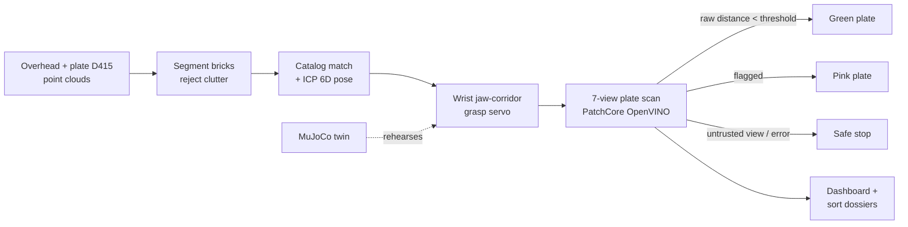

<div align="center">

# Brickcell

**An SO-101 arm that picks every DUPLO brick off a plate, scans it from seven angles, and sorts it good vs. defective — autonomously.**

[](pyproject.toml)
[](pyproject.toml)
[](pyproject.toml)
[](docs/SIMULATION.md)
[](docs/VALIDATION.md)

[**Watch the demo**](#demo) · [**Run it**](#quickstart) · [**Runtime numbers**](#runtime) · [**Docs**](docs/) · [**Validation log**](docs/VALIDATION.md)

Intel Physical AI Challenge · Junction 2026

</div>

---

A plate of mixed DUPLO bricks lands in front of the arm. The wrist camera finds the next graspable brick, the jaw-corridor servo centers it, the arm presents it to the plate camera from seven scheduled views, a calibrated PatchCore model scores it in raw patch distance, and the brick lands on the green plate or the pink plate. Anything the cell cannot trust — a missing view, a stale frame, an absent threshold — stops the sort instead of guessing.

Everything runs on CPUs: the SO-101 follower arm, three cameras (overhead D415, plate D415, wrist UVC), a calibrated PatchCore anomaly model exported to OpenVINO, and a MuJoCo digital twin used to rehearse cycles and validate perception before touching hardware.

## Demo

<div align="center">

<video src="demo_media/full-cycle.mp4" width="720" controls muted></video>

<sub>A full pick–inspect–sort cycle on the physical cell. <a href="demo_media/full-cycle.mp4">MP4</a></sub>

<table>
<tr>
<td><video src="demo_media/grasp-servo.mp4" width="340" controls muted></video><br><sub>Wrist-camera jaw-corridor grasp servoing</sub></td>
<td><video src="demo_media/plate-scan.mp4" width="340" controls muted></video><br><sub>Seven-view plate-camera anomaly scan</sub></td>
</tr>
<tr>
<td><video src="demo_media/sort-green.mp4" width="340" controls muted></video><br><sub>Clean brick → green plate</sub></td>
<td><video src="demo_media/defect-reject.mp4" width="340" controls muted></video><br><sub>Flagged brick → pink plate</sub></td>
</tr>
</table>

</div>

## What it actually does

| | |
| --- | --- |
| **Sees the whole plate** | Overhead + plate D415 point clouds segment touching DUPLO bricks across 7 physical colors and reject non-brick clutter (arms, wires, trash) with geometric and chromatic gates. |
| **Infers what it holds** | Each brick is matched against a part catalog (`3437` 2×2, `3011` 2×4, `76371` 1×2×2, `2302` 2×3 curved top) with a 6D pose refined by cuboid ICP, including upside-down and side-lying stable poses. |
| **Servos onto the brick** | Wrist-camera inner-jaw corridor servoing trims the grasp to brick-center before contact — no open-loop plunge. |
| **Inspects from 7 views** | The wrist joint sweeps the held brick through scheduled plate-camera poses; a PatchCore model calibrated on 707 real plate-camera images scores each view in **raw patch distance, never a probability**. |
| **Sorts conservatively** | `distance < threshold 2.453849` → green plate. Flagged → pink plate. Missing views, stale frames, inspector errors, or an absent threshold → **refuses to sort**. Mock action completion is never treated as physical success. |
| **Rehearses in a twin** | A MuJoCo 4.0.1 cell mirrors the measured station (calibrated camera poses, CAD-derived arm dynamics, KALAS plates) so perception and cycles are exercised before hardware. |
| **Explains itself live** | A dashboard streams decision state (`/api/status`), camera feeds, and per-brick dossiers; every sort record carries model provenance and threshold. |

## How a cycle runs



## Runtime

Measured on the shipped configuration — labeled by where the measurement was actually taken. Synthetic and mock results are marked; no real-defect accuracy is claimed beyond them.

| Metric | Value | Where measured |
| --- | --- | --- |
| PatchCore OpenVINO inference | **5.17 ms** mean · 5.24 p50 · 5.66 p95 | Apple M4 Max CPU, `infer()` only, 30 calls |
| Real2Sim perception latency | **128.6 ms** / frame | Live D415 clouds (8,738 pts/frame) on Intel station |
| Arm state mirror | read-only, live `q_enc_rad` → MuJoCo | Physical SO-101 via `armd`, no motion commands sent |
| Camera streams | 640×480 @ 15 fps per D415 · 1080p30 wrist | Physical station, `configs/rgbd-viewer.json` |
| Sorter unit tests | **51 passed** | Intel server, `uv run pytest` |
| Held-out synthetic test | TN=6, TP=6, FP=0, FN=0 | Software consistency check — **not** a real-defect result |
| Arm kinematics fit | **0.436°** validation RMS (from 3.023° unfitted) | Published CAD priors fit, `configs/published_priors_verified.json` |
| Anomaly threshold | `2.453849` raw distance · margin `0.002937` | Validation-calibrated, `plate-calibrated-707-v1` (`6d8add3e0688a925`) |

## Repo map

| Path | What lives there |
| --- | --- |
| [`src/brickcell/block_inspector/`](src/brickcell/block_inspector/) | The cell: perception, grasp servoing, scan schedule, sorting rule, `armd` boundary |
| [`src/brickcell/simulation/`](src/brickcell/simulation/) | MuJoCo digital twin and Real2Sim closed-loop pipeline |
| [`camera-ui/`](camera-ui/) | Camera-wall UI for the three inspection cameras |
| [`dashboard/`](dashboard/) | Live decision dashboard (status API, camera feeds, 3D HUD) |
| [`physical-ai-studio/`](physical-ai-studio/) | Embedded SO-101 pick-inspect-place workbench for Intel Physical AI Studio |
| [`services/`](services/) | BabyROS nodes: wrist anomaly detector, bowl tracker, camera publisher |
| [`configs/`](configs/) | Camera/scene calibration, viewer configs, verified arm priors |
| [`tools/lerobot/`](tools/lerobot/) | One-shot `teleop.sh` + aligned leader→follower teleoperation |
| [`scripts/`](scripts/) | Deploy to Intel (`deploy_to_intel.ps1`), evidence publishers, audits |
| [`docs/`](docs/) | Validation log, architecture, sorter policy, model handoff |
| [`demo_media/`](demo_media/) | Recorded demo cycles on the physical cell |
| [`tests/`](tests/) | Unit + model + simulation test suites |

## Quickstart

The core inspection environment is locked (`uv.lock`, `anomalib==2.7.0`, torch CPU). MuJoCo/IK dependencies stay in a separate venv.

```bash
# Core environment (macOS arm64 / Linux x86_64, Python 3.12)
uv sync --locked
uv run pytest

# Sim dependencies — isolated venv, do not add to the locked env
uv venv artifacts/arch-venv --python 3.12
uv pip install --python artifacts/arch-venv -r configs/arch-local-requirements.txt
uv pip install --python artifacts/arch-venv --no-deps -e .
```

**Digital twin sorting cell** (8 bricks, closed-loop Real2Sim):

```bash
artifacts/arch-venv/bin/mjpython -m brickcell.block_inspector real2sim --num-blocks 8 --seed 42   # macOS
artifacts/arch-venv/bin/python  -m brickcell.block_inspector real2sim --num-blocks 8 --seed 42   # Linux
```

**Physical cell** (on the Intel station, one cycle):

```powershell
.\scripts\deploy_to_intel.ps1 -MaxCycles 1        # sync + launch from a laptop
```

```bash
# or on the server — calibrated plate PatchCore is the default inspection mode
PYTHONPATH=src .venv/bin/python -m brickcell.block_inspector.cli deploy-cell \
  --max-cycles 1 --inspection-mode patchcore-plate --hud-port 0 \
  --output-dir artifacts/sort-run
```

**Teleoperation:** `tools/lerobot/teleop.sh start|status|attach|stop` — leader→follower on the Intel server over SSH.

## Invariants

- Anomaly scores are **raw patch distances, never probabilities**.
- Train only on good images; calibrate on `val`; evaluate once on `test`. Object and session IDs are leakage groups.
- `RobotInterface`, `FrameSource`, `Inspector` are the integration boundaries — detector modules never command the robot.
- Invalid views, uncertainty, stale results, missing thresholds, and timeouts never cause a sort on an untrusted result.
- `.venv`, `.cache`, `data`, `artifacts`, keys, and `.env` stay out of Git.

## Docs

[Validation log](docs/VALIDATION.md) (executed checks vs. planned work) · [Architecture](docs/ARCHITECTURE.md) · [Heuristic sorter policy](docs/HEURISTIC_SORTER.md) · [Model handoff](docs/MARK_MODEL_HANDOFF.md) · [Simulation](docs/SIMULATION.md) · [Intel deployment](docs/INTEL_DEPLOYMENT.md) · [Agent rules](AGENTS.md)
