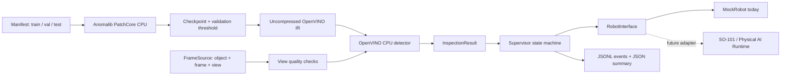
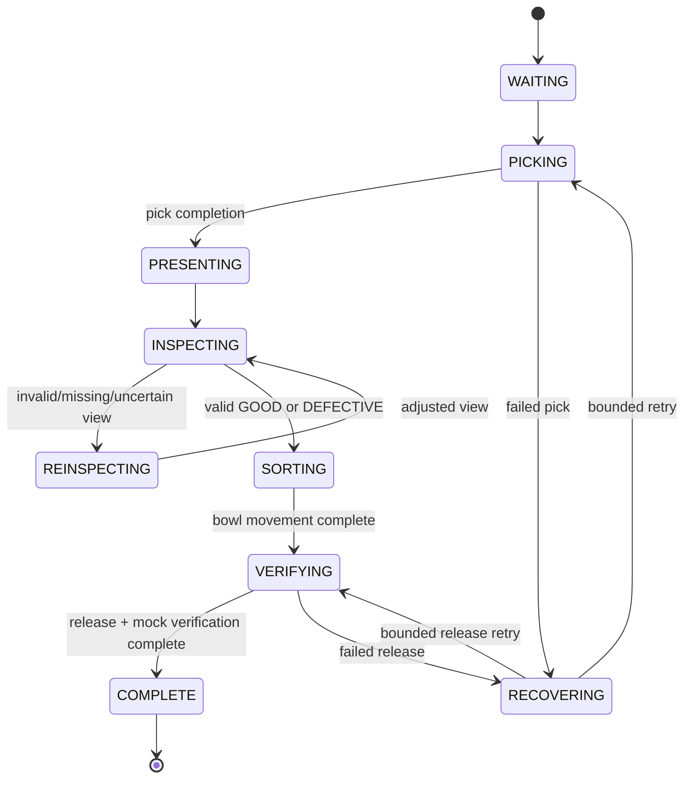

# Architecture

Brickcell is a local software inspection cell. It does not contain a real robot driver or a learned manipulation policy.

## Module responsibilities

| Module | Contract |
| --- | --- |
| `data` | JSON manifest, image validation, group-safe partitioning, synthetic fixtures |
| `detector` | Anomalib adapter, checkpoint provenance, export, CPU inference, parity |
| `inspection` | RGB conversion, view-quality gate, calibrated decisions, structured results |
| `sources` | `FrameSource.capture(object_id, attempt)` returns a frame for that exact object |
| `controller` | State transitions, bounded retries/deadlines, action tokens, safe stopping |
| `metrics` | Classification metrics, latency statistics, JSONL event persistence |

The detector takes RGB images and returns raw PatchCore scores and maps. It has no knowledge of robot actions. `InspectionService` attaches the frame identity and applies the quality/threshold contract. `Supervisor` accepts any `Inspector` and `RobotInterface` implementation. An SO-101 adapter replaces `MockRobot`; it does not change training or inference code.

## Dataset and model isolation

The verified Anomalib 2.7.0 `Folder` signature defaults to `test_split_mode=FROM_DIR`, `val_split_mode=FROM_TEST`, `val_split_ratio=0.5`; absent normal test images may also cause a normal training split. We do not use those defaults. See [tagged Folder implementation](https://github.com/open-edge-platform/anomalib/blob/lib/v2.7.0/src/anomalib/data/datamodules/image/folder.py).

`ManifestDataset` supplies official `ImageItem` objects and `ImageBatch.collate` through explicit PyTorch loaders to `Engine.fit(train_dataloaders=..., val_dataloaders=...)`. Only good `train` rows build the PatchCore memory bank. `val` is explicitly calibration/model-development data. No test loader is passed to `Engine`. Test images are only decoded/hashed for integrity during validation; their predictions never determine thresholds or model parameters.

Anomalib's post-processor and evaluator are disabled deliberately. After fitting, validation scores calibrate an external raw-score threshold by maximum image-level F1, breaking ties toward the lower threshold/greater recall. The optional uncertainty margin is a configured fraction of the validation 5th–95th percentile score range. This is a heuristic abstention region, not a statistical confidence interval or probability calibration. Production recall objectives should replace the max-F1 objective using validation data.

`evaluate` uses the frozen threshold and independent `test` rows. It rejects changed manifest membership/image bytes. Changing camera, object family, lighting or preprocessing requires new calibration and a new untouched test set. Repeatedly selecting models based on test metrics invalidates its held-out status.

## Preprocessing and export

1. Pillow decodes, applies EXIF orientation, and converts grayscale/RGBA to RGB.
2. A shared Pillow bilinear resize establishes the fixed `(H,W)` size before collation or inference.
3. RGB uint8 becomes NCHW float32 in `[0,1]`. No caller-side ImageNet normalization occurs.
4. PatchCore's official preprocessor supplies its configured resize (already at target size) and ImageNet normalization. In Lightning it runs as a callback; in direct `model(tensor)` and export it runs in `forward`.
5. Raw `pred_score` and `anomaly_map` are exported through `Engine.export(export_type='openvino', compression_type=None)`. The verified export uses ONNX dynamo/opset 18 and a static batch-one input.
6. OpenVINO compiles with `device_name='CPU'` and f32 precision hint. `model.json` supplies threshold, input size, model version, preprocessing description, and XML/BIN hashes. All three exported files must travel together.

Parity compares direct checkpoint inference with OpenVINO on identical validation RGB inputs. The default absolute score tolerance is 0.001, and decisions must also agree. Map overlays use per-image min/max scaling for visualization only; red intensity is not a calibrated defect probability. Raw maps are saved as `.npy`.

## Controller behavior

Any movement failure/timeout, stale result, exhausted retry budget, or unhandled exception leads to `ERROR`, safe stop, disconnect, and termination of that run. There is no automatic next object after a stop. The error path attempts stopping even if logging fails. Pick/release failures have bounded retries; missing/invalid/uncertain views get at most the configured number of adjustments. A directory with only one image per object cannot invent an additional view; exhausted frames stop the run safely.

Every action has a unique action token and object ID. Results must match the current frame's object ID, frame ID, view ID, and timestamp; reused frame IDs are rejected. The inspector runs in a daemon worker with a bounded wait. A late worker has only a private result queue and no robot reference. After timeout the run stops; do not reuse that inspector instance. Python cannot kill its worker safely, so a real deployment should isolate an untrusted/blocking inference service in a process with a watchdog.

Robot and camera adapter calls must be nonblocking or implement their own I/O deadlines. Polling cannot preempt a driver that blocks inside a method. A physical driver needs hardware watchdogs and an emergency stop independent of Python. `MockRobot.verify_release` is mocked; `SimRobot.verify_release` checks MuJoCo bowl occupancy and settling. Neither verifies physical hardware success.

## Optional camera-to-MuJoCo integration

`simulation.server` runs in the isolated MuJoCo environment and owns physics, rendering and the Viser viewer. `simulation.run` runs in the core environment, composing the unchanged supervisor and `InspectionService` with `SimRobot` and `SimCamera`. Loopback HTTP carries nonblocking action tokens, polled completion, fresh PNGs and their frame identities. No fixture labels cross the camera interface. Rendered training and capture share one fixed image crop. The simulator validates the published camera-result identity and destination before starting bowl motion.

Scripted IK controls simulated joint actuators and contact grasps; scene state supplies pickup poses and simulation-only grasp/placement verification. An actual-model test changes pixels while retaining an identical object ID and verifies that the bowl command changes. The live marked test performs the full contact-physics workflow. Details and limits are in `SIMULATION.md`.

## Quality limits and reporting

The quality gate checks luminance variation, Laplacian variance, border-estimated background foreground fraction, and the fraction of foreground outside a configured ROI. It assumes a single isolated object and a reasonably uniform background. It can reject legitimate low-texture/dark objects and accept clutter or partial objects. Review real images and tune on calibration data; this is not an object detector and cannot guarantee visibility.

JSONL events include robot/inspector mode, object identity, transitions, actions and inspection results. JSON summaries include attempts, completed mock cycles, decisions, reinspection counts, timeouts, errors and cycle latency. Detector latency measures `infer()` only, including the first call unless a benchmark explicitly warms up. Preprocessing, image loading, model compilation and overlay saving are excluded. Cycle latency includes control/logging/inspection work. p50 needs two samples; p95 needs twenty. Synthetic and physical metrics must never be conflated.
